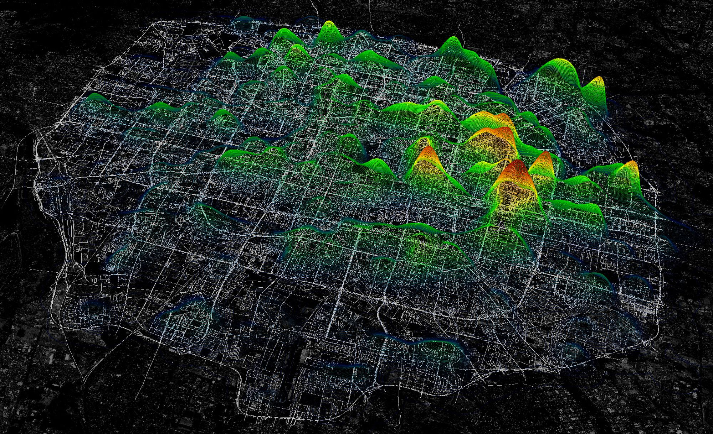
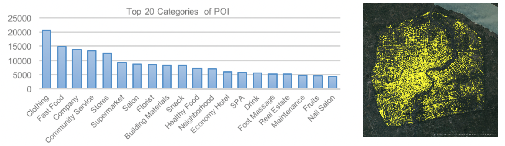
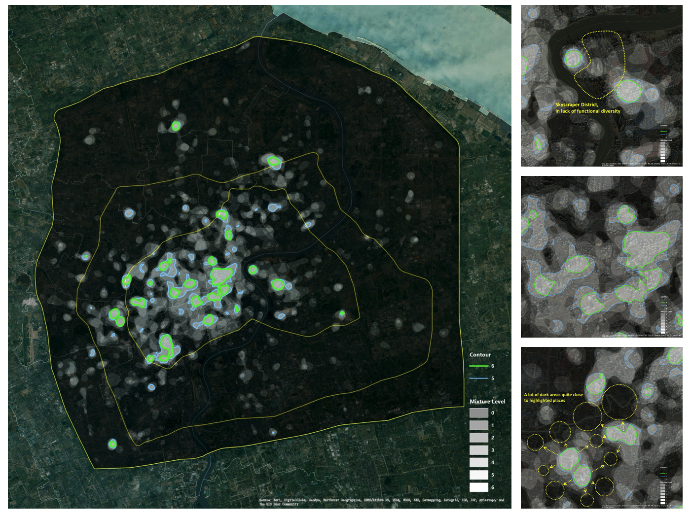
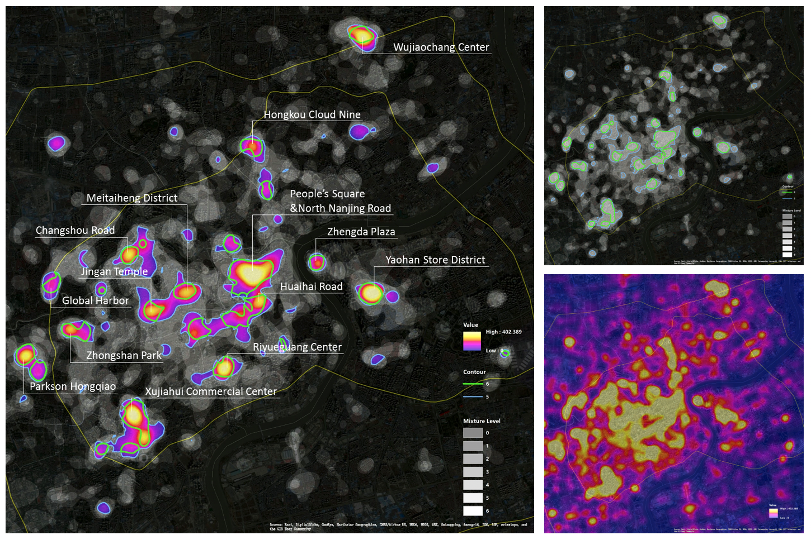
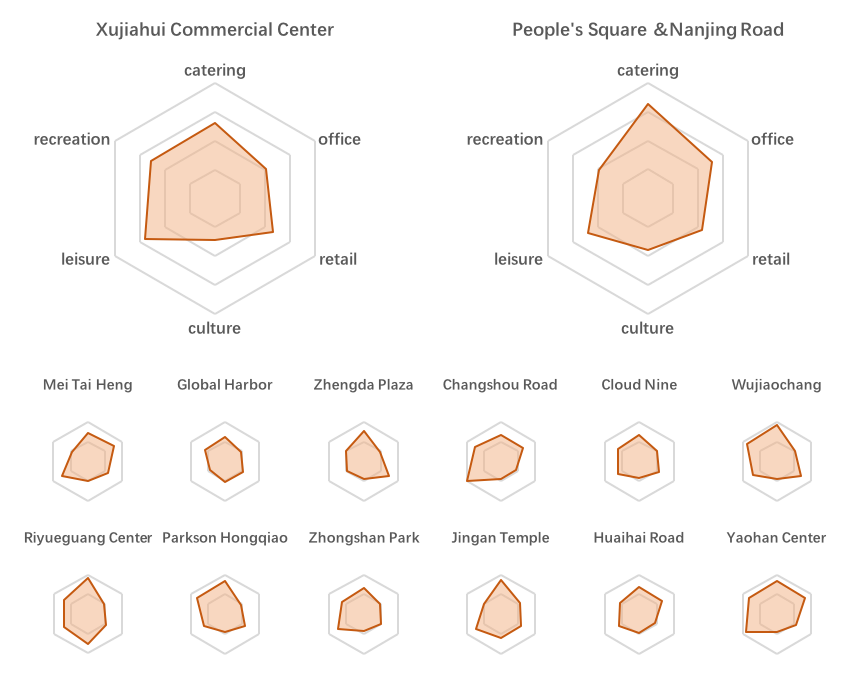
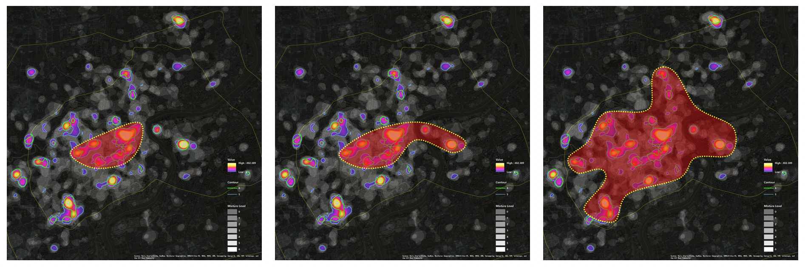

```{=html}
<style>
.quarto-title-banner {
  background-position: 50% 50%;
  height: 200px;
}
</style>
```

::: {.callout-note .project-context}
## Research context

**Research during my planning practice at the China Academy of Urban Planning and Design**<br>
I developed this study with Zhuqing Liu during my CAUPD period, before CitoryTech. It uses Shanghai POI data from August 2016; the related [Springer book chapter](../../papers/#central-activity-zones) was published in 2018.
:::

# Planning question {#the-idea}

How can a city identify a central activity zone where several urban functions overlap? This study examined both the intensity and diversity of activities in Shanghai, using evaluated points of interest to compare potential boundaries rather than relying on a single concentration of offices or shops.

{fig-alt="Shanghai Central Activity Zone analysis overview." loading="lazy"}

# Dataset {#dataset}

The analysis assembled **386,628 POI records** within Shanghai's outer ring, updated to **August 2016**. Sources included Dianping and Anjuke. Records were organized into six categories: retail, catering, office, recreation, leisure, and culture. Available attributes, including ratings and prices, supported the evaluation of individual places.

{fig-alt="Points of interest used to analyze Shanghai's central activities." loading="lazy"}

# Method {#method}

The method combines two dimensions of functional mixture:

1. **Intensity:** normalize and aggregate category-specific value maps to locate concentrations of activity.
2. **Diversity:** overlay the category maps to identify places where several functions intersect, using entropy to characterize functional mixture.

{fig-alt="Shanghai value-aggregation map and an enlarged central area." loading="lazy"}

{fig-alt="Functional-intersection map with three detailed Shanghai locations." loading="lazy"}

{fig-alt="Combined functional-mixture maps and fourteen selected Shanghai areas." loading="lazy"}

# Comparing candidate zones {#finding-the-most-dynamic-areas}

Combining intensity and diversity identified areas with substantial activity across multiple functions. The analysis highlighted **fourteen mixed-use areas** within the middle ring and used them to explore alternative definitions of the central activity zone. The maps characterize the POI mix; they do not directly measure pedestrian activity or social life.

{fig-alt="Selected mixed-use activity concentrations in Shanghai." loading="lazy"}

{fig-alt="Three alternative Central Activity Zone boundaries for Shanghai." loading="lazy"}

# Publication

Liu, L., & Liu, Z. **The Recognition of CAZ in Shanghai Based on Evaluated POI.** In Z. Shen & M. Li (Eds.), *Big Data Support of Urban Planning and Management*. Springer. [Chapter](https://link.springer.com/chapter/10.1007/978-3-319-51929-6_6) · [Publication entry](../../papers/#central-activity-zones).
