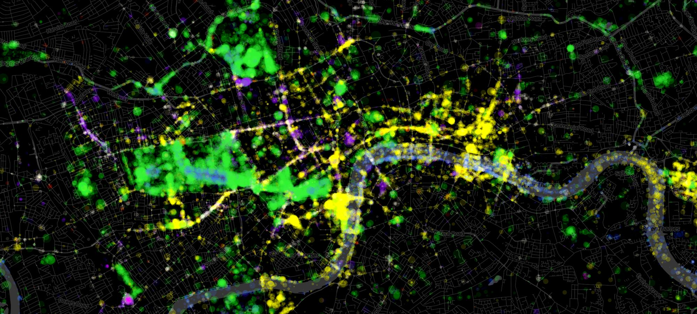
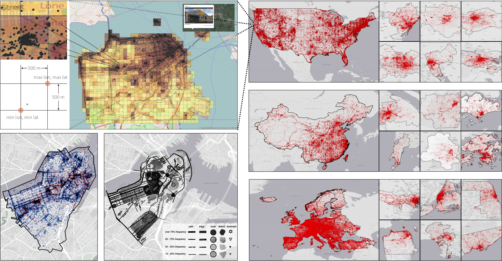
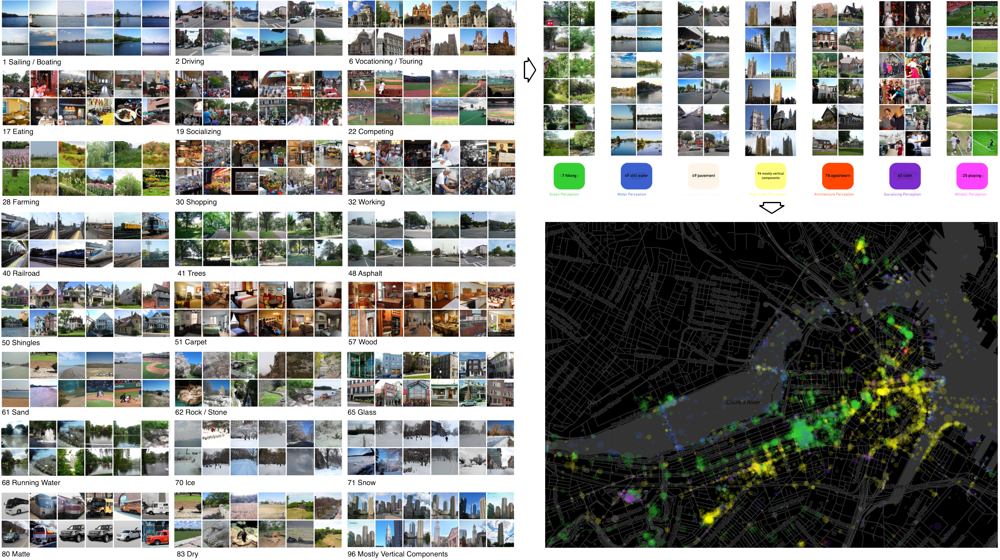
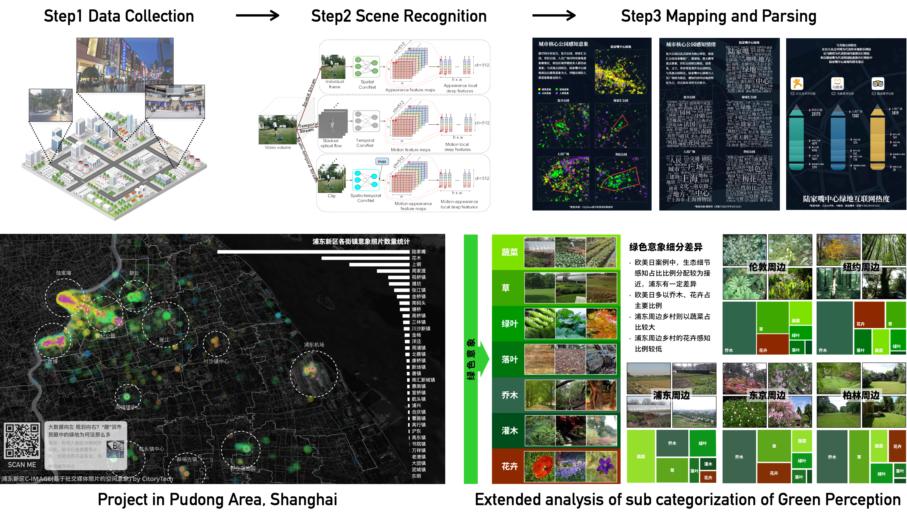

```{=html}
<style>
.quarto-title-banner {
  background-position: 50% 50%;
  height: 200px;
}
</style>
```

::: {.callout-note .project-context}
## Research context

**MIT master's thesis and related research**<br>
I developed C-IMAGE to study the city as represented in geotagged photographs, working with Bolei Zhou on image analysis. The work led to papers in [*GeoJournal*](../../papers/#c-image) and at [ECCV](../../papers/#city-identity).
:::

# Research question {#the-idea}

What can photographs reveal about the places people choose to record? Building on Kevin Lynch's study of the image of the city, C-IMAGE used scene recognition to map recurring features in user-contributed photographs across **26 cities**. These maps describe the photographed city: they reflect contributors' choices and platform coverage, rather than a representative survey of residents' perceptions.

{fig-alt="Overview of the C-IMAGE city-image mapping project." loading="lazy"}

# Data and processing {#data-processing}

Photographs and geographic coordinates were collected through the Panoramio and Flickr APIs. The broader collection reached approximately **30 million images**. Coordinates linked image classifications to locations, allowing visual patterns to be compared within and across cities.

{fig-alt="C-IMAGE data-collection and image-processing workflow." loading="lazy"}

# Scene classification {#scene-classification}

The project used [Places scene-recognition models](http://places.csail.mit.edu/) to classify image content into **102 attributes**. Classes relevant to public space were then organized into seven broader visual categories for mapping. This translated a large image collection into a smaller set of interpretable spatial layers.

{fig-alt="Examples of image classifications in the C-IMAGE project." loading="lazy"}

# Mapping the photographed city {#mapping-the-perceptions}

Mapping these categories reveals where different parts of a city's public image are concentrated. For example, comparing greenery-related photographs in Shanghai and Tokyo provides a way to examine differences in the places represented in each collection. Such comparisons need to account for uneven photography and platform use.

{fig-alt="City maps showing the distribution of C-IMAGE visual categories." loading="lazy"}

# More detailed categories {#other-cases}

The same workflow can support finer classifications. In a subsequent application, the greenery category was divided into seven subcategories to distinguish different forms of green-space imagery.

{fig-alt="C-IMAGE application separating greenery into more specific visual categories." loading="lazy"}

# Interactive maps {#interactive-maps}

The original interactive maps have been recovered from my archive:

[Amsterdam](./amsterdam/index.html), [Bangkok](./bangkok/index.html), [Barcelona](./barcelona/index.html), [Beijing](./beijing/index.html), [Hong Kong](./hongkong/index.html), [Kuala Lumpur](./kuala_lumpur/index.html), [London](./london/index.html), [New Delhi](./new_delhi/index.html), [New York](./new_york/index.html), [Paris](./paris/index.html), [Prague](./prague/index.html), [San Francisco](./san_francisco/index.html), [Seoul](./seoul/index.html), [Shanghai](./shanghai/index.html), [Singapore](./singapore/index.html), [Tokyo](./tokyo/index.html), [Toronto](./toronto/index.html), [Vienna](./vienna/index.html), [Zurich](./zurich/index.html).

# Demonstration {#demo-video}

The video shows the spatial distribution of image-classification results in Shenzhen.



# Publications and related work

- Liu, L., Zhou, B., Zhao, J., & Ryan, B. D. **C-IMAGE: City Cognitive Mapping through Geo-Tagged Photos.** *GeoJournal*. [Paper](https://link.springer.com/article/10.1007/s10708-016-9739-6) · [Publication entry](../../papers/#c-image).
- Zhou, B., Liu, L., Oliva, A., & Torralba, A. **Recognizing City Identity via Attribute Analysis of Geo-Tagged Images.** *European Conference on Computer Vision*, 519–534. [Paper](https://link.springer.com/content/pdf/10.1007/978-3-319-10578-9_34.pdf) · [Publication entry](../../papers/#city-identity).
- [More project visualizations](../../visualization/#project-visualizations).
