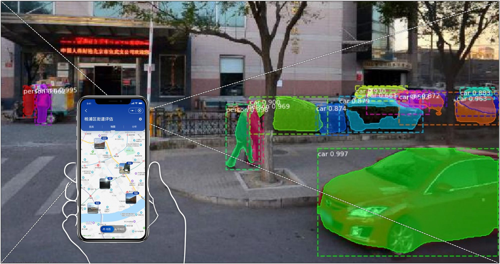
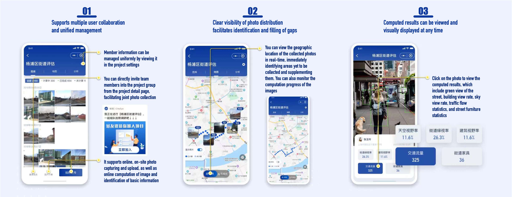
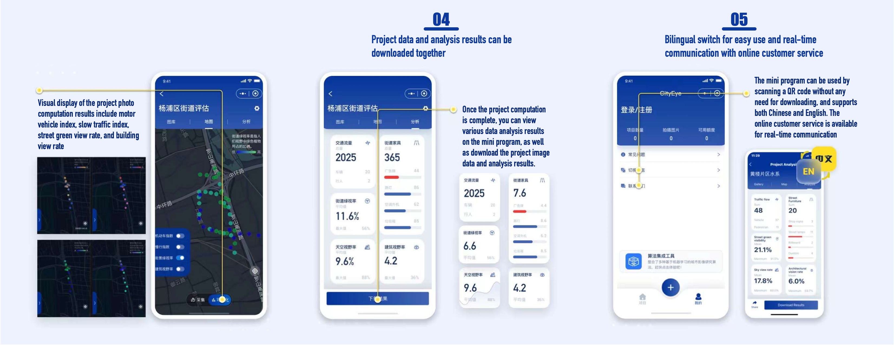

```{=html}
<style>
.quarto-title-banner {
  background-position: 50% 50%;
  height: 200px;
}
</style>
```

::: {.callout-note .project-context}
## Project context

**CitoryTech product development** · Collaborative field photography<br>
**My role:** Project lead, working with Ding Zhang and Jinxin Shao. CityEye was a WeChat mini application for group field surveys. The service has since closed; this page documents the product and its workflow.
:::

# Field-survey workflow {#the-idea}

Group fieldwork often leaves photographs scattered across individual phones and chat threads. CityEye connected participants to a shared survey project, letting a team contribute photographs and review them in a common geographic workspace.

{fig-alt="Overview of the CityEye group photo-survey tool." loading="lazy"}

# Product functions {#the-function-of-the-app}

The tool combined image collection, recognition, and analysis. Participants could upload photographs through WeChat, while the shared workspace organized images for review and mapping. This made a group survey's observations available for subsequent planning or research analysis.

{fig-alt="CityEye mobile field-survey interface examples." loading="lazy"}

{fig-alt="CityEye image-management and analysis interface examples." loading="lazy"}

# Related product development

CityEye became the collaborative image-collection module within [Qiuhao](../qiuhao/), alongside visual-indicator analysis and image-based perception surveys.

For further information about the archived product, [contact me](mailto:lyons66@mit.edu).
