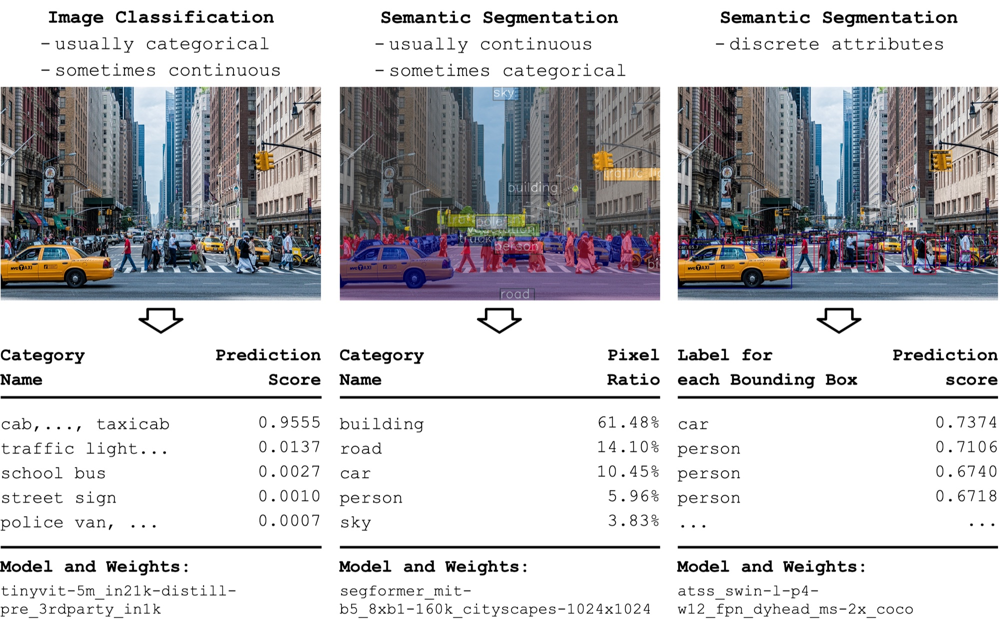
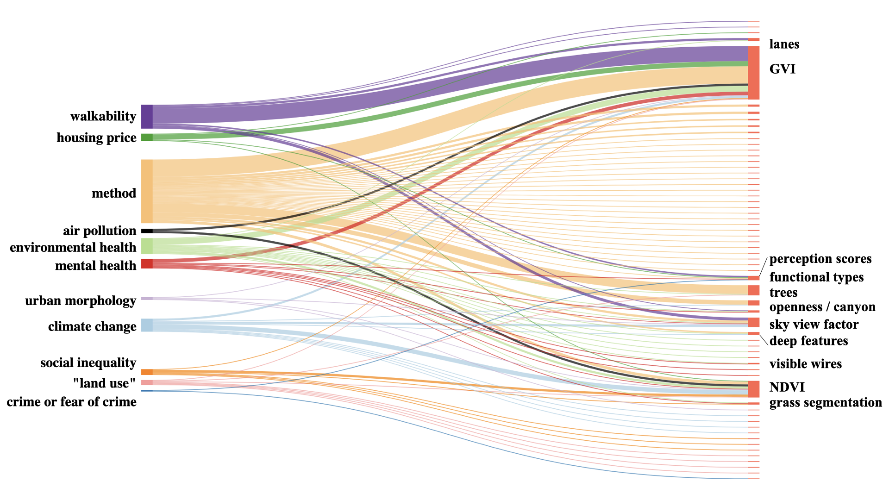

```{=html}
<style>
.quarto-title-banner {
  background-position: 50% 45%;
  height: 200px;
}
</style>
```

::: {.callout-note .project-context}
## Research context

**Independent research at MIT with my advisor, Andres Sevtsuk**<br>
This review examined what computer vision measures in urban studies and planning. Published in [*Cities* in 2024](../../papers/#clarity-or-confusion), it analyzes **146 papers** and **104 street attributes**, with a closer assessment of 24 quantitative studies. Its gaps in the measurement of human activities and interactions shaped my dissertation, [Sidewalk Ballet](../seeing_hai/).
:::


# Research question {#the-question}

The paper asks three related questions: What specific data can computer vision collect that interests planners and urban designers? How have planning researchers actually used these data? And what fundamentally new knowledge has computer vision contributed to planning?

Traditional observation — the tradition of Whyte, Gehl, Lynch, and Jacobs — is rich but labor-intensive and hard to repeat across a city. Computer vision promises to extend the counting and mapping of street environments with far less effort. Whether that promise has translated into clear, well-defined measures is the question the title poses.

# Review scope {#what-the-review-covers}

A three-stage screening of the Web of Science identified 146 influential papers, from which we extracted and classified 104 distinct street attributes into four groups:

1. **Visual Dominants** — large scene components such as greenery, sky, buildings, and roadways, mostly measured as pixel ratios from semantic segmentation.
2. **Micro-Level Details** — discrete elements such as street furniture, signs, wires, and pavement condition, typically from object detection.
3. **Composite Metrics** — indices assembled from multiple attributes, such as walkability, bikeability, and perception scores.
4. **Deep Features** — learned representations without direct physical definitions, used in perception and scene-comparison studies.

{fig-alt="Image classification, semantic segmentation, and object detection illustrated as three street-image data models." loading="lazy"}

*The three data models behind CV street attributes: image classification, semantic segmentation, and object detection, each producing a different data type for urban analysis.*

The review then traces how these attributes flow into research topics — walkability, housing prices, health, climate, safety — across the quantitative studies that use them.

{fig-alt="Diagram linking urban research topics to computer-vision street attributes." loading="lazy"}

*How research topics (left) draw on CV-derived street attributes (right) across the reviewed literature. A small set of attributes, led by greenery, serves most topics.*

# Findings {#key-findings}

Beyond the catalog itself, the review identifies three structural problems in the field:

- **Ambiguity of definitions.** Many attributes lack clear, consistent definitions; the same term can denote different measurements across papers.
- **Unbalanced research focus.** Effort concentrates on model and feature selection, while measurement validity and standardization receive far less attention.
- **Unclear effectiveness.** In the 24-paper subcollection, how much explanatory power street attributes add to urban models is often difficult to establish.

Across the review, many different urban questions depend on a small family of readily extractable metrics, especially greenery. This creates a mismatch between what urbanists want to understand and what computer vision is equipped to measure. Human activities and interactions — central to classic observational studies of public life — remain weakly represented.

The review calls for clearer definitions and standardized measurement. It also shaped the starting point for [Sidewalk Ballet](../seeing_hai/), my dissertation: begin with an urban question, define the observable evidence it requires, and then develop the method to measure it.

# Related materials {#related-material}

- [Sidewalk Ballet, my dissertation research](../seeing_hai/)
- [MINGLE, the group-detection method](../mingle/)
- [Published paper](https://doi.org/10.1016/j.cities.2024.105022) · [Publication entry](../../papers/#clarity-or-confusion)
