```{=html}
<style>
.quarto-title-banner {
  background-position: 50% 50%;
  height: 200px;
}
</style>
```

::: {.callout-note .project-context}
## Project context

**CitoryTech product development** · AI-assisted photography prototype<br>
**My role:** Project lead, working with Ding Zhang and Xin Xiong. The prototype provided composition and scene-based suggestions while a user framed a photograph. Development ended in 2020 as tourism declined.
:::

# Product idea {#the-idea}

The camera app translated image analysis into guidance at the moment of photography. It recognized the current scene and composition, then offered reference photographs or overlaid guidelines to help users consider alternative framing.

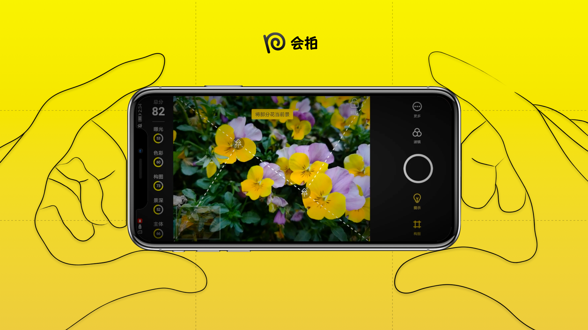{fig-alt="AI-assisted camera app overview." loading="lazy"}

# Composition guidance {#function-1-composition-recognization}

The prototype classified composition into **12 main categories and 34 subcategories**. It used these classifications to suggest framing options for the current camera view.

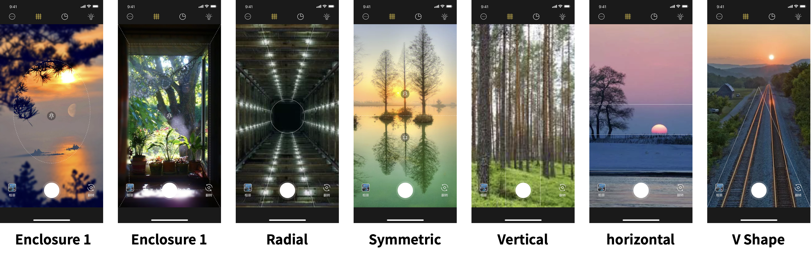{fig-alt="Camera-app composition category examples." loading="lazy"}

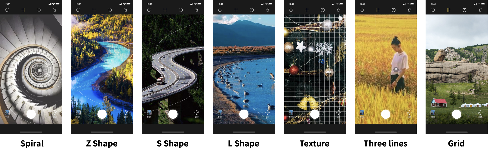{fig-alt="Composition-recognition examples from the camera prototype." loading="lazy"}

One form of feedback overlaid guidelines directly on the camera image:

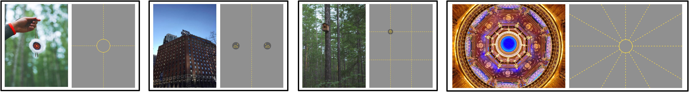{fig-alt="First example of guidelines overlaid on a camera frame." loading="lazy"}

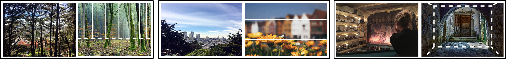{fig-alt="Second example of guidelines overlaid on a camera frame." loading="lazy"}

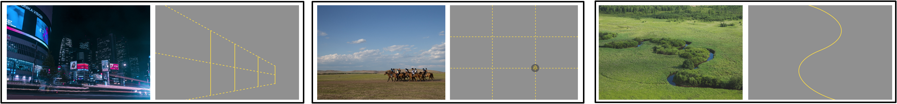{fig-alt="Third example of guidelines overlaid on a camera frame." loading="lazy"}

The app also displayed reference photographs with related compositions:

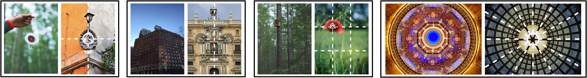{fig-alt="First set of composition reference photographs." loading="lazy"}

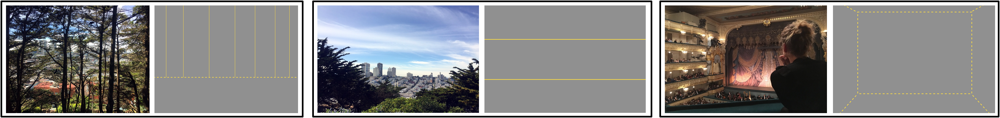{fig-alt="Second set of composition reference photographs." loading="lazy"}

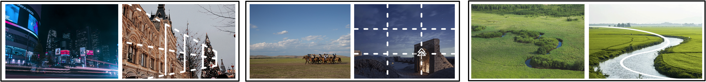{fig-alt="Third set of composition reference photographs." loading="lazy"}

# Scene-based suggestions {#function-2-suggestions-based-on-scenes}

Scene recognition covered **26 main categories and more than 100 subcategories**. The prototype identified subjects and scene types to provide context-specific suggestions. For portraits, it also distinguished poses such as standing and sitting.

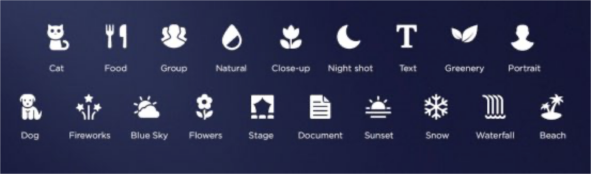{fig-alt="Scene-based photography suggestions in the camera app." loading="lazy"}

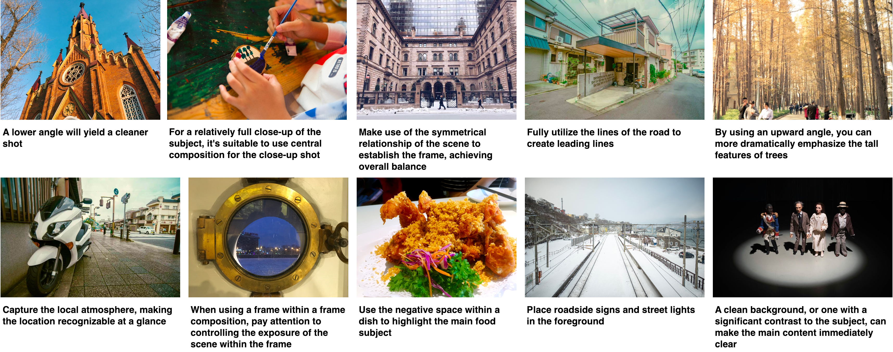{fig-alt="AI-assisted camera prototype interface examples." loading="lazy"}

# Demonstration {#demo-video}

This demonstration was recorded in Shanghai on **April 30, 2020**, using a Huawei Mate 30.



# Related materials

- [Business plan](https://www.dropbox.com/scl/fi/a5sbkv6chnl8cn9mgvpkt/BP-universal-2.pdf?rlkey=iclka76tnlumoq8gv9mrfucyi&dl=0) · Password-protected; [contact me](mailto:lyons66@mit.edu) for access.
- [More project visualizations](../../visualization/#project-visualizations).
