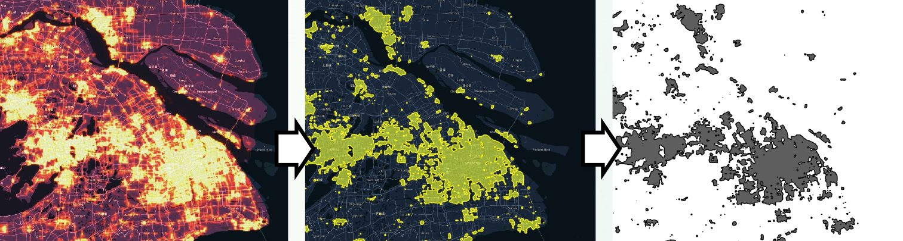
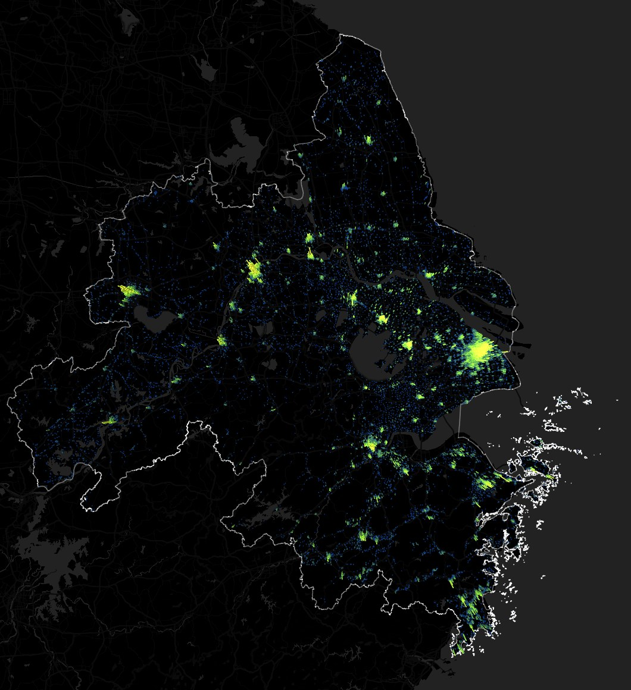
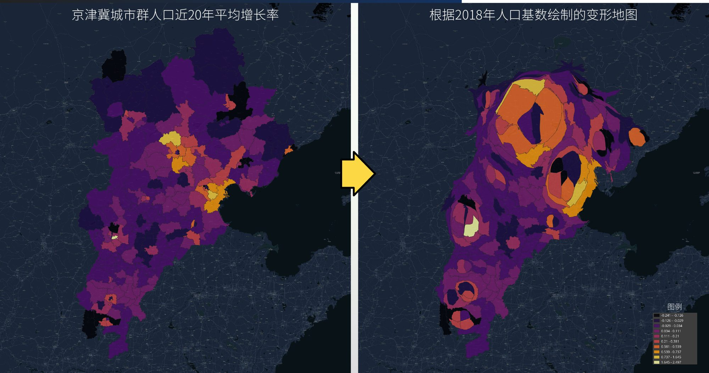
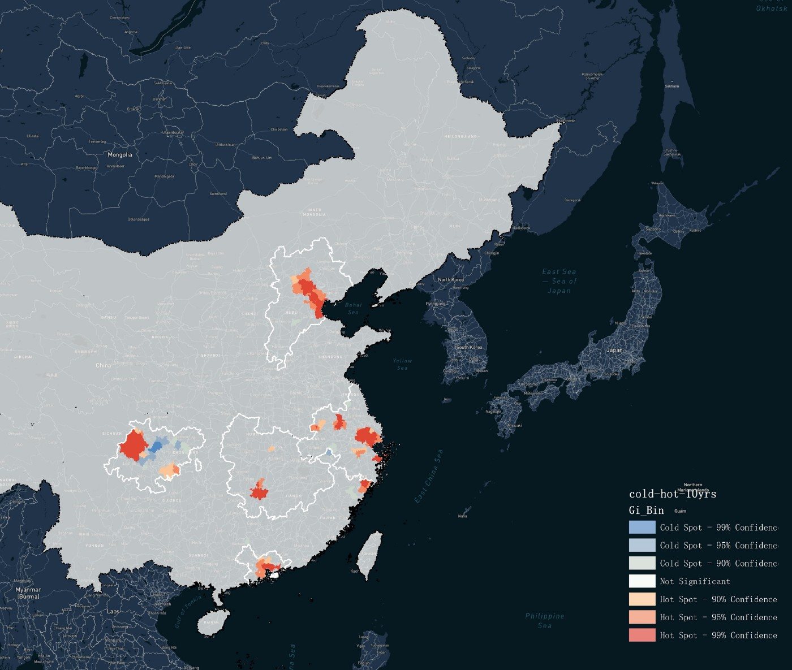
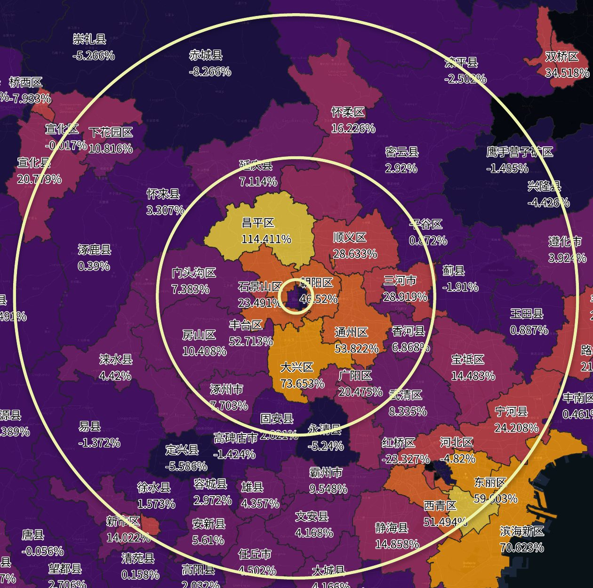
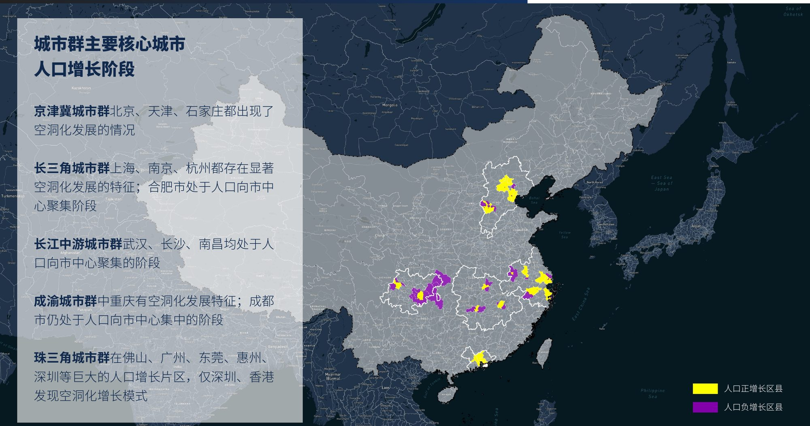
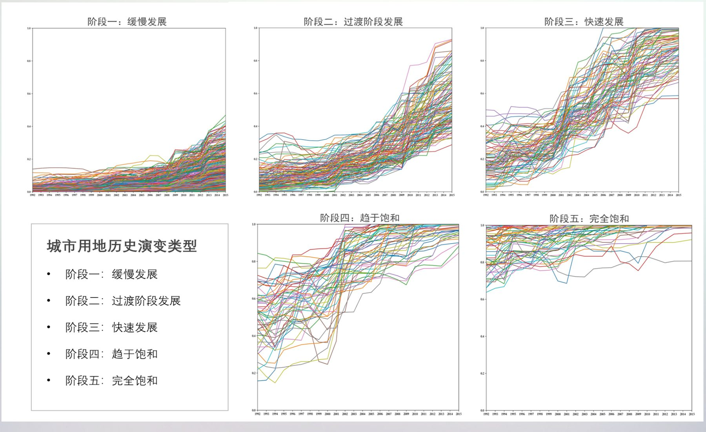
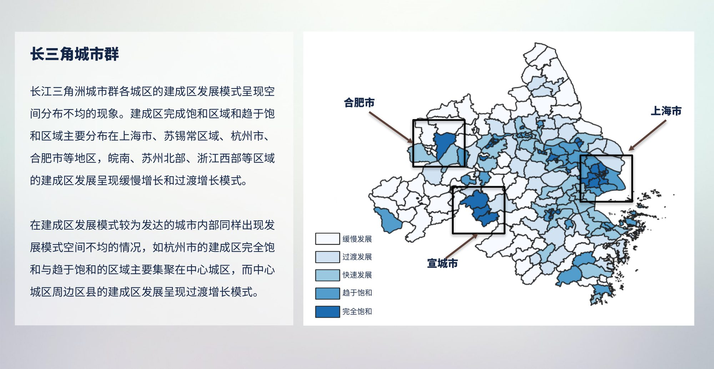
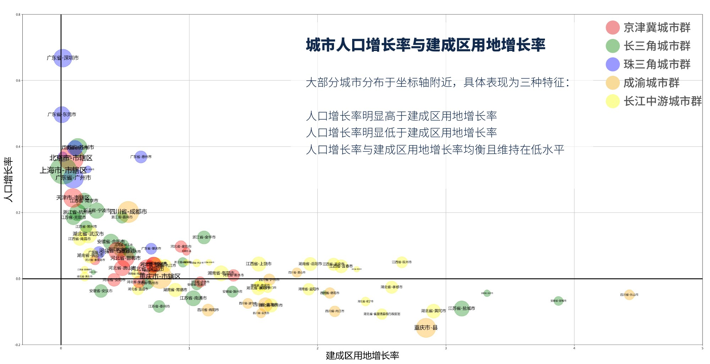
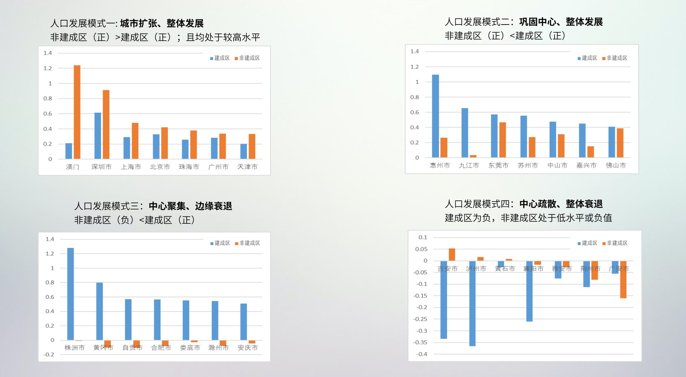

::: {.callout-note .project-context}
## Project context

**Commissioned research for Jinmao Group · CitoryTech · 2020** 
**My role:** Project lead at CitoryTech.

[Watch the population and urban growth visualization](../../visualization/#urban-growth-2020).
:::

# The question

Land and people do not always grow together. Some cities fill their existing footprint with ever more residents, while others keep building as their populations stall or fall. This study asked **where people were concentrating, where urban land was expanding, and where the two diverged**, across China’s five major city regions: Beijing–Tianjin–Hebei, the Yangtze River Delta, the Pearl River Delta, Chengdu–Chongqing, and the middle reaches of the Yangtze River.

I led the CitoryTech team that built the analysis and the 124-page report delivered in November 2020. Rather than rely only on administrative statistics, which describe whole jurisdictions, we measured population and built-up land on consistent grids and summarized them at the city and county levels. That made it possible to compare a city’s core with its edge, one region with another, and population change with land change in the same units.

# Two satellite-derived records

**Population.** We used the LandScan grids from Oak Ridge National Laboratory, which estimate ambient population at a 30-arc-second resolution, roughly 1 km, for each year. The study covers 2000–2018.

**Built-up land.** Night-time lights record where settlement is lit. We combined DMSP imagery (1992–2013) and VIIRS imagery (2015–2016) into one long series, fitting the records to each other where they overlapped. To decide how bright a pixel had to be to count as built-up, we tested a range of light thresholds and compared the resulting areas with the built-up areas reported in China’s urban construction yearbooks. Thresholding combined with spatial statistics then gave built-up boundaries year by year.

{fig-alt="Three panels of Shanghai: a night-time light map, the same area with pixels above a brightness threshold highlighted, and a black-and-white map of extracted built-up areas." loading="lazy"}

# Where people concentrated, 2000–2018

The population analysis moved from the national scale to each city region and then into its core cities. Growth rates were mapped for 348 city units and for county-level units. **Cartograms scaled to 2018 population** corrected a basic problem of conventional maps, in which a large, sparsely settled county dominates the picture while holding few people. Redrawn by population, the high-growth edges of Beijing and Tianjin stand out far more clearly.

{fig-alt="Dark top-down map of the Yangtze River Delta in which grid cells glow green and yellow with population density, brightest around Shanghai and several other city centers." loading="lazy"}

{fig-alt="Two maps of the Beijing–Tianjin–Hebei region. The left shows growth rates on a standard map. The right distorts each unit by its 2018 population, enlarging Beijing and Tianjin." loading="lazy"}

A hot-spot analysis (Getis-Ord Gi\*) then asked where high or low growth clustered beyond chance. The Yangtze River Delta and Pearl River Delta formed strong regional growth clusters, while much of the area around Chengdu–Chongqing appeared as cold spots of low or negative growth.

{fig-alt="Map of statistically identified population-growth hot spots and cold spots in the five Chinese city regions." loading="lazy"}

**Inside the core cities, growth was often hollow.** In Beijing, the central Dongcheng district lost population and neighboring Xicheng grew slowly, while the strongest growth sat in a middle ring of districts such as Changping and Daxing, with slower growth farther out. We called this pattern hollowed growth and looked for it in each region’s core cities. Beijing, Tianjin, Shijiazhuang, Shanghai, Nanjing, Hangzhou, and Chongqing showed it, as did Shenzhen and Hong Kong within the broadly growing Pearl River Delta. Hefei, Wuhan, Changsha, Nanchang, and Chengdu were still drawing people toward their centers.

{fig-alt="Map of Beijing districts colored by population growth, with three concentric circles. Central districts show decline, a middle ring shows high growth, and outer districts show slower growth." loading="lazy"}

{fig-alt="Map of eastern China highlighting districts of major core cities in yellow for growth and purple for decline, with a Chinese summary panel." loading="lazy"}

We also fitted exponential growth curves to each region’s cities. The average fitted rates were low, about 0.5–0.6% a year across the five regions, and population had not yet bent into the S-shaped curve that signals saturation. Urban land, as the next section shows, already had.

# How urban land expanded, 1992–2016

For each county-level unit, we computed the **share of its administrative area that was built up** in every year from 1992 to 2016. Plotted over time, these shares trace each place’s rhythm of expansion. In Suzhou, for example, several districts jumped from well under half built-up to near saturation in the few years after 2000.

Clustering these trajectories produced **five stages of land development**: slow development, transitional growth, rapid growth, approaching saturation, and fully saturated. Mapping the stages showed how unevenly each region had built out. In the Pearl River Delta, most cities were in rapid growth, approaching saturation, or saturated, and Shenzhen, Dongguan, and Zhongshan had long been saturated. In the Yangtze River Delta, saturation was concentrated in Shanghai, the Suzhou–Wuxi–Changzhou area, Hangzhou, and Hefei. Chengdu–Chongqing was polarized: the central districts of its two cores were saturated, most other places were still in slow or transitional growth, and no unit was in the approaching-saturation stage.

{fig-alt="Five small-multiple line charts of built-up share over time, labeled in Chinese as slow, transitional, rapid, approaching saturation, and saturated." loading="lazy"}

{fig-alt="Map of the Yangtze River Delta with county-level units shaded from white (slow development) to dark blue (saturated), and a Chinese explanatory panel." loading="lazy"}

# Where people and land diverged

The final part brought the two records together. Plotting each city’s population growth against its built-up-land growth sorted most cities into three types:

- **Population densification**: high population growth with little new land, typical of leading centers such as Beijing, Shanghai, Guangzhou, and Shenzhen, whose built-up land was already close to saturation.
- **Land-led expansion**: rapid growth of built-up land with stagnant or falling population, found mainly in cities of Chengdu–Chongqing and the middle Yangtze that lagged others in their regions.
- **Balanced low growth**: both rates moderate and low, typical of second-tier cities in Beijing–Tianjin–Hebei, the Yangtze River Delta, and the middle Yangtze.

{fig-alt="Scatterplot comparing population growth on the vertical axis and built-up-area growth on the horizontal axis, colored by city region." loading="lazy"}

A second comparison split each city’s population growth between its built-up and non-built-up areas, which yielded four modes: expansion with overall growth, where non-built-up areas grew faster than built-up ones (Shenzhen, Shanghai, Beijing); a consolidating center with overall growth (Huizhou, Dongguan, Suzhou); a growing center with a declining periphery (Zhuzhou, Hefei, Anqing); and a dispersing center with overall decline (Ji’an, Luzhou, Xiangyang).

{fig-alt="Four bar charts, each comparing population growth in built-up and non-built-up areas for seven example cities, with Chinese titles for each mode." loading="lazy"}

# What the study suggested

The clearest lesson was that **adding urban land did not, by itself, bring people**. Over the long run, the cities that gained population were those already strong within their regions, while many cities that expanded land quickly lost residents. The report also proposed that core cities in the strongest regions were beginning to draw people from farther away while spreading growth to their neighbors, whereas inland cores still drew mainly from their own surroundings, which could deepen decline at their edges. These were forward-looking interpretations for the client, not tested forecasts.

# My role and the limits of the evidence

I led the CitoryTech team’s work, from the analytical framework to the delivered report and its interactive visualization. The grid analysis ran on spatial SQL and Python notebooks, with GIS mapping and cartograms for the regional comparisons.

Both records are estimates. LandScan models where people are likely to be rather than counting residents, and night-time light measures lit settlement rather than land use or floor area. The comparisons describe patterns of change. They do not establish that land development caused, or failed to cause, population growth in any particular city.

Figures: CitoryTech project report, 2020, with original Chinese labels. Related work: [National Mobility Networks in China](../lbsn/), which examines regional connections through population movement.
