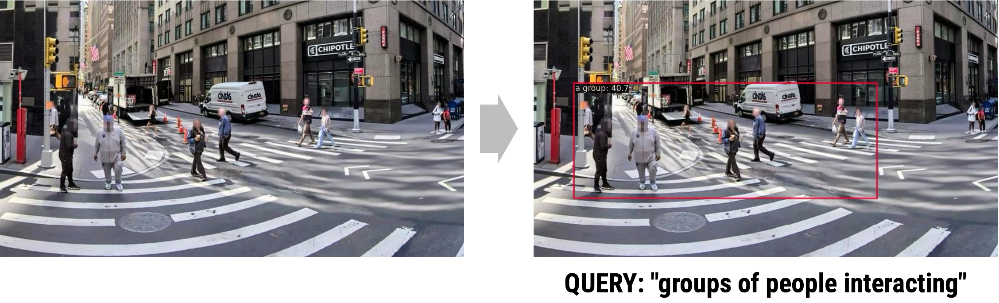
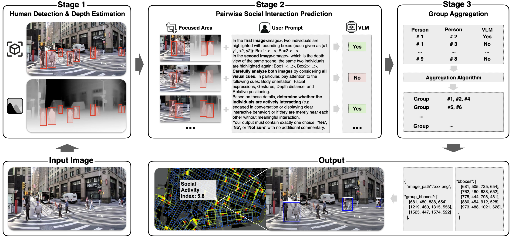
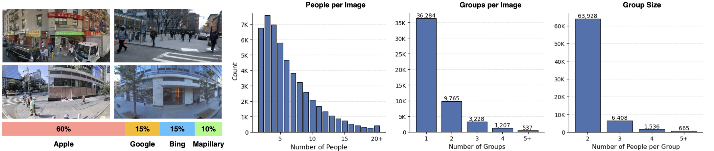

```{=html}
<style>
.quarto-title-banner {
  background-position: 50% 40%;
  height: 200px;
}
</style>
```

::: {.callout-note .project-context}
## Research context

**Method developed within my MIT dissertation, [Sidewalk Ballet](../seeing_hai/)**<br>
**My role:** Lead author, working with collaborators at MIT and the Hasso Plattner Institute. [MINGLE was published at AAAI 2026](../../papers/#mingle), in the AI for Social Impact Track. It also supports the [City Form Lab collaboration exhibited at Venice](../sidewalk_ballet/).
:::

People can usually recognize who is interacting with whom in a street scene, but a social group has no fixed visual boundary. MINGLE (**M**ulti-person **I**nteraction-aware **N**eural **G**roup **L**ocalization and **E**xtraction) combines person detection, depth-aware vision-language reasoning, and spatial aggregation to locate these groups. The paper also introduces annotations and metadata for **100,000 urban street images**.


# Research question {#the-problem}

William H. Whyte, Jan Gehl, and Allan Jacobs established the importance of observing where and how people gather in public space. Their methods required trained fieldworkers at selected locations, producing detailed observations that were difficult to repeat across a city.

Street-view imagery makes it possible to revisit this observational tradition at a larger scale. Detecting social interactions in these images can support comparisons between human co-presence, accessibility, street design, and land use.

The core difficulty is semantic complexity. A social group has no fixed shape, color, or texture. It is defined by relationships such as proximity, body orientation, shared gaze, and co-movement.

Off-the-shelf detectors locate individuals. Identifying a group requires a further judgment about their relationships; the zero-shot VLM baselines tested in this study performed poorly on group-region detection.

{fig-alt="Three approaches to identifying people and social groups in the same street scene." loading="lazy"}

*Figure 1. Comparison of three approaches on the same New York street scene. MINGLE (top) correctly identifies and localizes socially interacting groups with tight bounding boxes. Traditional object detection (middle) has no category for "social group." Zero-shot VLM prompting (bottom) produces noisy, unreliable results.*

When queried with "groups of people interacting," the tested open-vocabulary detector returns one bounding box around one person rather than the relationship among people.

{fig-alt="Person-detection stage of the MINGLE workflow." loading="lazy"}

*Figure 2. Open vocabulary detection given the query "groups of people interacting" (right) detects only one individual, failing to capture any social group structure.*

# MINGLE pipeline {#the-mingle-pipeline}

MINGLE solves the problem in three stages, each addressing a distinct challenge:

## Stage 1: Person detection

An ATSS-Swin-L-DyHead detector first identifies all individual people in the scene with high-confidence bounding boxes. This separates the problem of *finding people* from the problem of *reasoning about their relationships*.

## Stage 2: Pairwise affiliation classification

For every pair of detected individuals, MINGLE constructs a prompt containing:

- **RGB crops** of each person's bounding box
- A **depth-map crop** of the scene, generated by a monocular depth estimator
- **Numeric depth values and absolute depth differences** inserted directly into the text prompt

This multimodal prompt is fed to a **fine-tuned Qwen2-VL / Qwen2.5-VL** model, which classifies each pair as *interacting*, *not interacting*, or *uncertain*. Depth cues help distinguish image-plane proximity from estimated physical separation, which is important when perspective places unrelated people close together in an image.

Computational cost is managed by filtering out pairs whose image-plane distance or depth difference exceeds configurable thresholds, reducing the number of VLM calls with limited loss of accuracy in the reported experiments.

## Stage 3: Group aggregation

A greedy clustering algorithm merges pairwise classifications into group regions. A set of two or more individuals with mutual "interacting" links forms a social group, and a bounding box is computed from the extreme coordinates of its members. The resulting **social group region** represents collective structure rather than a single body.

{fig-alt="Three-stage MINGLE pipeline and examples of group-region outputs." loading="lazy"}

*Figure 3. The full MINGLE pipeline (top row) and its output format (bottom row). Stage 1 detects individuals; Stage 2 classifies each person pair using depth-aware VLM prompts; Stage 3 aggregates pairs into group bounding boxes. The bottom row shows how group detections and a Social Activity Index are computed for a given street image.*

# Dataset

MINGLE includes a **100K-image annotated dataset** for social-group detection in urban street-view imagery. Images were sourced from four providers to ensure geographic and visual diversity:

| Source | Share |
|---|---|
| Apple Look Around | 60% |
| Google Street View | 15% |
| Bing Streetside | 15% |
| Mapillary | 10% |

The dataset contains **588,430 human instances** and **72,537 annotated social group regions**, combining manual human labels with pipeline-validated pseudo-labels. A separate pairwise fine-tuning set of **79,265 annotated person pairs** was collected to train the VLM classifier (76K training / 2K test), with human labels of "Yes," "No," or "Not Sure" for each pair.

{fig-alt="Source shares and descriptive statistics for the MINGLE dataset." loading="lazy"}

*Figure 4. Dataset composition and statistics. Left: source distribution across four street-view providers. Right: histograms of people per image, groups per image, and group size.*

# Results

The paper reports performance for both pairwise classification and the complete group-detection pipeline:

**Pairwise classification** (Table 2 in the paper):

| Model | F1 | Precision | Recall |
|---|---|---|---|
| GPT-4o (zero-shot) | 0.00 | — | — |
| Qwen2-VL (zero-shot) | 0.53 | — | — |
| **MINGLE (fine-tuned, 76K)** | **0.70** | **0.73** | **0.66** |

**Full pipeline: social group region detection** (Table 3):

| Method | mIoU | F1 | Precision | Recall |
|---|---|---|---|---|
| Baseline VLMs | ~0.00–0.02 | — | — | — |
| **MINGLE** | **0.64** | **0.60** | **0.75** | **0.61** |

The tested baseline VLMs produce near-zero region-detection scores. In these experiments, combining specialized person detection with depth-grounded pairwise reasoning substantially improves performance.

The depth and distance filtering ablation (Table 4) shows that aggressive filtering reduces VLM calls substantially with minimal impact on accuracy, making the pipeline practical for city-scale deployment.

# Publication

> Liu, L., Kudaeva, A., Cipriano, M., Al Ghannam, F., Tan, F., de Melo, G., & Sevtsuk, A. (2026). **MINGLE: VLMs for Semantically Complex Region Detection.** *Proceedings of the AAAI Conference on Artificial Intelligence*, 40(45). [https://doi.org/10.1609/aaai.v40i45.41239](https://doi.org/10.1609/aaai.v40i45.41239)

[Publication entry](../../papers/#mingle) · arXiv preprint: [arxiv.org/abs/2509.13484](https://arxiv.org/abs/2509.13484)
