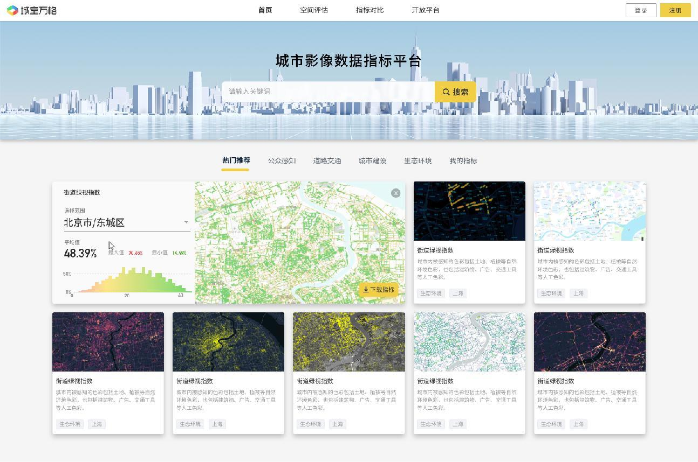
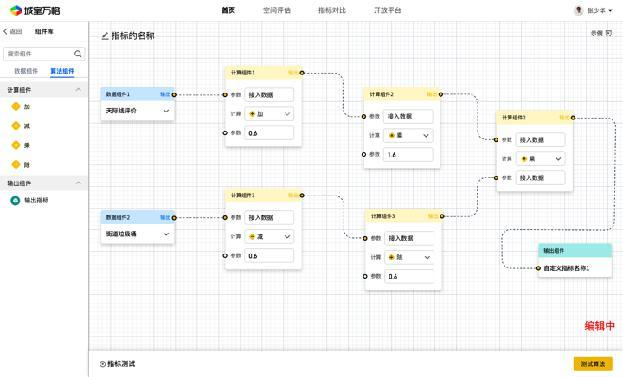
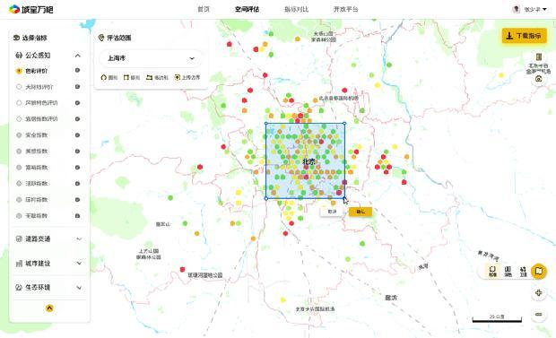
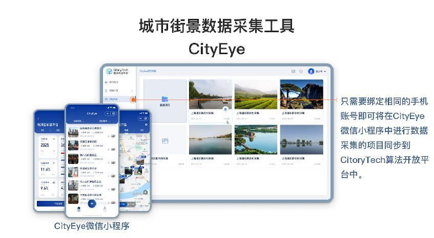
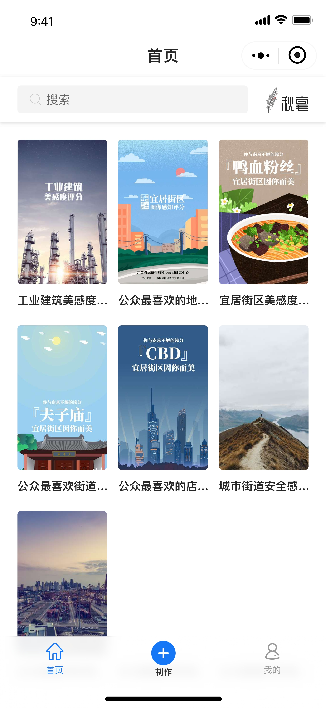
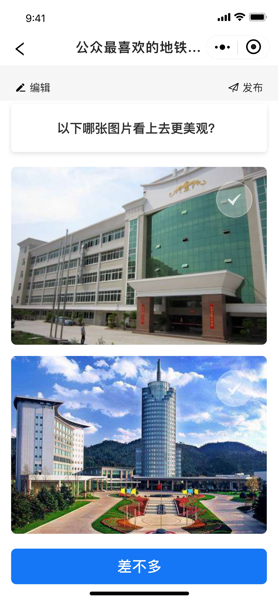
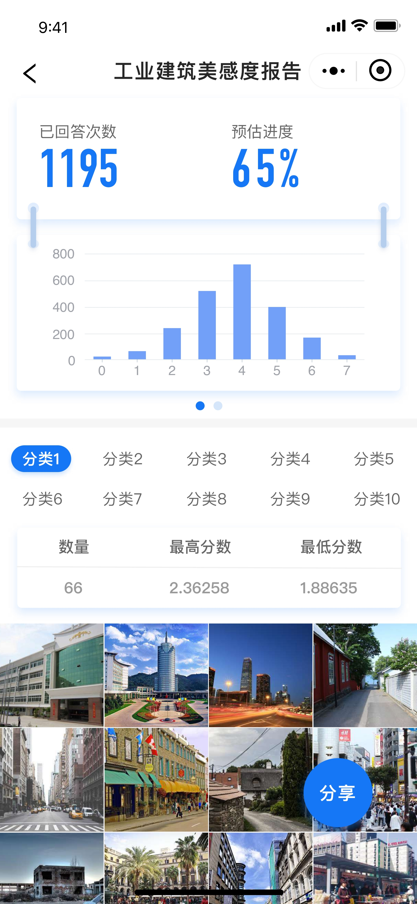

```{=html}
<section class="qiuhao-intro" aria-label="Qiuhao project overview">
  <div class="qiuhao-overview">
    <p class="qiuhao-context">CitoryTech product development · 2021</p>
    <p><strong>Qiuhao</strong> brings together tools for collecting urban imagery, learning how people perceive places, and mapping image-based indicators of environmental quality. It grew from recurring needs in our planning and consulting projects.</p>
    <p>My role: founder and director of CitoryTech, leading the team behind the product.</p>
  </div>
</section>
```

# From individual projects to a shared workflow

Our clients asked different questions about the urban environment: which streets felt comfortable to walk along, where neighborhood conditions needed attention, or how to assess road infrastructure and storefront design. These projects repeatedly required the same underlying work: gathering images, organizing human assessments, running computer vision models, and connecting the results to geographic locations.

Qiuhao organized this work into three connected modules. Its Chinese name, 秋毫, refers to noticing fine details. The product's focus was to make visible features of urban space available for systematic assessment and planning decisions.

```{=html}
<div class="qiuhao-modules" aria-label="Three Qiuhao product modules">
  <a href="#visual-indicator-platform">
    <span class="qiuhao-module-label">Module A</span>
    <strong>Visual indicator platform</strong>
    <span>Analyze imagery and compare places through maps and indicators.</span>
  </a>
  <a href="#collaborative-image-collection">
    <span class="qiuhao-module-label">Module B</span>
    <strong>Collaborative image collection</strong>
    <span>Collect field photographs and connect them to online analysis.</span>
  </a>
  <a href="#image-based-perception-surveys">
    <span class="qiuhao-module-label">Module C</span>
    <strong>Image-based perception surveys</strong>
    <span>Gather visual preferences and use them to support assessment models.</span>
  </a>
</div>
```

# Visual indicator platform {#visual-indicator-platform}

The platform organizes image-derived spatial data into a workspace for exploring environmental conditions. Users can browse indicators, select a study area on a map, and compare patterns across locations. The interface connects maps with summary statistics and image examples, so users can examine the observations behind an indicator.

{width=100%}

Low-code tools support the construction of analysis workflows. Other views support geographic selection and the visualization of spatial variation. These functions were designed to help planning teams work with image-based evidence through a common interface.

```{=html}
<div class="qiuhao-interface-pair">
  <figure>
    <a href="low-code-workflow.jpg" class="lightbox" data-gallery="qiuhao-platform"></a>
    <figcaption>Low-code workflow: connect processing steps through a visual interface.</figcaption>
  </figure>
  <figure>
    <a href="spatial-selection.jpg" class="lightbox" data-gallery="qiuhao-platform"></a>
    <figcaption>Spatial selection: define an area and inspect its image-derived indicators.</figcaption>
  </figure>
</div>
```

The product design supported a standard SaaS service and private deployments with customized modules. The business plan presented the [Ulaanbaatar road-condition assessment platform](../road/) as an example of a project-specific deployment.

# Collaborative image collection {#collaborative-image-collection}

The collection module connects fieldwork with image analysis. [CityEye](../cityeye/), a WeChat mini application, lets participants contribute photographs to a shared survey project, browse a common image collection, and locate observations on a map. It provides a practical way for a group to document a site together.

{width=100%}

An algorithm platform connects the collected imagery to recognition services, image management, map visualization, and data downloads. Customized collection workflows also supported panoramic cameras and vehicle-mounted cameras. The [Tianjin Xincun neighborhood assessment](../livable_neighborhoods/#field-survey) shows how a walking survey with a 360° camera could bring narrow residential lanes into this type of assessment.

# Image-based perception surveys {#image-based-perception-surveys}

Visible objects alone do not describe how people experience a place. The survey module gathers judgments about images, including preferences concerning the appearance of buildings, streets, and neighborhoods.

In a pairwise survey, a participant sees two images and selects the one that better matches a stated criterion. Repeated comparisons provide preference data that can inform image ratings and the development of automated assessment models. The prototype connected study selection, image comparison, and results reporting in a mobile interface.

```{=html}
<div class="qiuhao-survey-screens" aria-label="Qiuhao perception-survey prototype">
  <figure>
    <a href="survey-home.jpg" class="lightbox" data-gallery="qiuhao-survey"></a>
    <figcaption><strong>Choose a study.</strong> Browse surveys about different places and visual qualities.</figcaption>
  </figure>
  <figure>
    <a href="survey-comparison.jpg" class="lightbox" data-gallery="qiuhao-survey"></a>
    <figcaption><strong>Compare two images.</strong> Answer a focused question about their visual qualities.</figcaption>
  </figure>
  <figure>
    <a href="survey-report.jpg" class="lightbox" data-gallery="qiuhao-survey"></a>
    <figcaption><strong>Review the results.</strong> Inspect rating distributions and image groups. Values shown are part of the original prototype.</figcaption>
  </figure>
</div>
```

Customized surveys could use different participant groups, interface designs, and annotation methods, including marking regions within images. The [StreeTalk project](../streetalk/) illustrates the earlier use of visual preferences to model perceived street safety and inform pedestrian routing.

# Use in planning practice

Qiuhao's modules could work together or support a specific stage of a project. A neighborhood study might combine field photography with residents' visual judgments and a map of local conditions. An infrastructure study could instead emphasize object recognition and a customized inspection interface.

The intended users included planning and design teams, urban management organizations, researchers, and commercial property teams. The common task was to turn images and assessments into spatial evidence that people could inspect and compare. Perception scores describe visual judgments; their interpretation depends on the survey question, participating population, and imagery used.

Related project pages: [CityEye](../cityeye/) · [Livable Neighborhood Assessment](../livable_neighborhoods/) · [Road Asset Assessment](../road/) · [StreeTalk](../streetalk/).

*Product interfaces and original logo: CitoryTech's 2021 materials. Descriptions and captions are in English; original Chinese interface images are preserved.*
