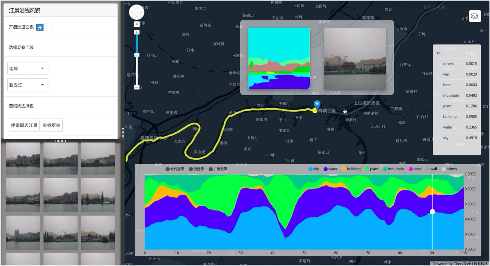
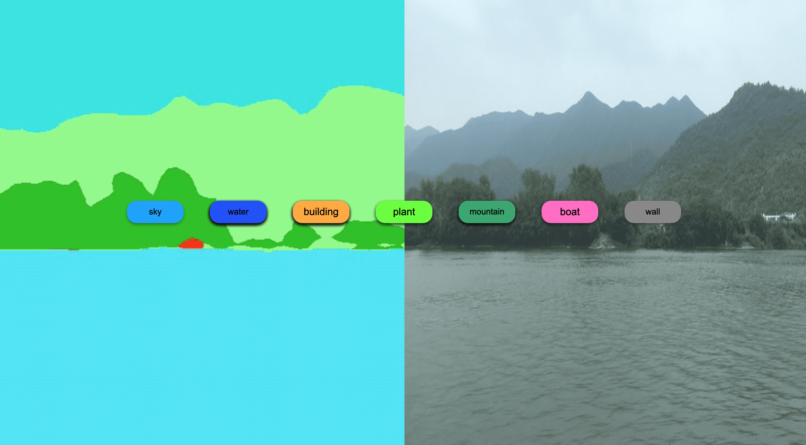
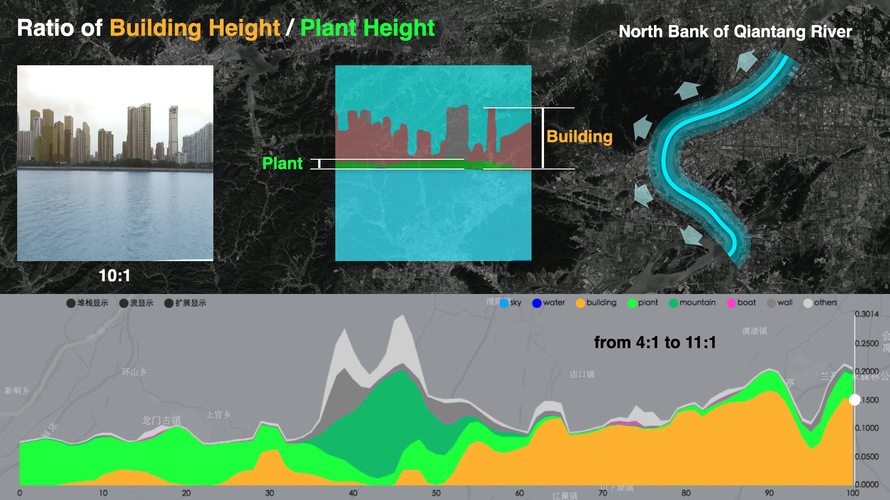
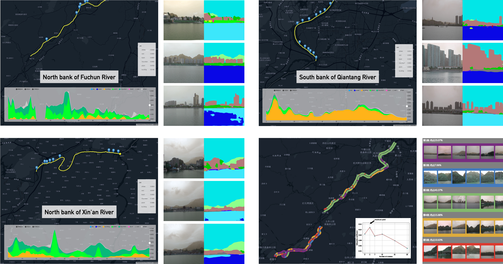

```{=html}
<style>
.quarto-title-banner {
  background-position: 50% 50%;
  height: 200px;
}
</style>
```

::: {.callout-note .project-context}
## Project context

**CitoryTech landscape-assessment project**<br>
**My role:** Project lead, developing video-based landscape measures and a geographic visualization interface. The study covered more than 200 km of waterfront along the Qiantang, Fuchun, and Xin'an rivers. It was later presented at [Rez de Ville / Urban Ground Floors 2023](../../presentations/#learning-from-ground-floors).
:::

# Planning question {#the-idea}

How can planners compare the visible character of a long, historically significant waterfront? This project used riverbank video to document natural features and development, creating a spatial record for examining where buildings and vegetation shaped the view.

{fig-alt="River View Analysis project overview." loading="lazy"}

# Data and processing {#data-process}

More than **40,000 frames** were extracted from video covering three sections along the north and south banks. Image segmentation estimated the visual proportions of **seven landscape elements**, and the results were connected to locations along the waterfront.

{fig-alt="Riverbank video processing and geographic organization." loading="lazy"}

{fig-alt="Riverbank frames segmented into landscape elements." loading="lazy"}

# Comparing waterfront conditions {#result-analysis}

The analysis compared the relative prominence of buildings and vegetation, including measures relating building height to plant height. These visual diagnostics helped locate sections for closer planning review; they describe the visible landscape rather than establish ecological impacts.

{fig-alt="Visual landscape measures along the riverbank." loading="lazy"}

{fig-alt="Section-level results from the riverfront landscape assessment." loading="lazy"}

# Demonstration {#demo-video}

The visualization platform links mapped indicators to the corresponding waterfront views, allowing users to inspect the evidence behind a measure.



[More project visualizations](../../visualization/#project-visualizations).
