::: {.callout-note .project-context}
## Research context

**MIT doctoral dissertation in Urban Science** · Expected completion: June 2027<br>
**Committee:** Andres Sevtsuk (chair), Jinhua Zhao, and Lawrence Vale.

*Sidewalk Ballet* connects a measurement framework, studies of sidewalk social life, and a national data resource. The related papers are:

- **Method:** [A Vision-Language Framework for Measuring Social Life on Sidewalks](../../papers/#sidewalk-social-life-framework), with Andres Sevtsuk — under review at *Computers, Environment and Urban Systems*; [preprint available](https://arxiv.org/abs/2609.28476).
- **Data:** [Stay Together: Street-Level Social Indicators for Sidewalk Life Across 496 U.S. Cities](../../papers/#stay-together), with Andres Sevtsuk — manuscript in preparation.
- **Methodological foundation:** [MINGLE](../../papers/#mingle) — published at AAAI 2026. The dissertation extends this group-detection work to activities and spatial measures; the findings study is ongoing.
:::

<span id="research-question" class="anchor-alias" aria-hidden="true"></span>

This project measures how people use sidewalks: who is moving or staying, who is together, and what they are doing. My MIT dissertation uses street-level images and vision-language models to extend close observation of public life across streets and cities. It asks what pedestrian counts miss when equally busy sidewalks support different activities and forms of social presence. The measures describe what is visible at the moment an image was captured.

# Same count, different public life {#count-vs-grouping}

Each pair below has nearly the same number of people, but shows very different forms of sidewalk social life.

```{=html}
<div class="count-comparisons" aria-label="Three image pairs from M10 Figure 8">
<div class="count-pair" role="group" aria-label="Comparison 1">
<figure>
  <a class="lightbox" href="sdi_low1.webp" data-gallery="count-pairs" data-title="Pair 1, left: N = 9. People on their own, mainly passing through.">
    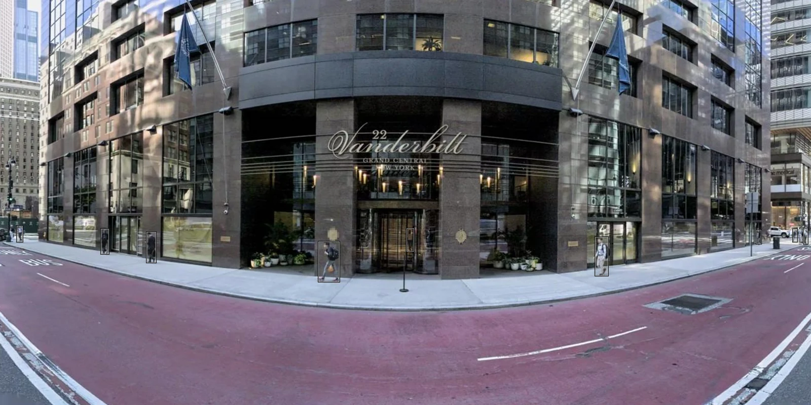
  </a>
  <figcaption><strong>N = 9.</strong> People on their own, mainly passing through.</figcaption>
</figure>
<figure>
  <a class="lightbox" href="sdi_high1.webp" data-gallery="count-pairs" data-title="Pair 1, right: N = 9. Groups and people standing or seated.">
    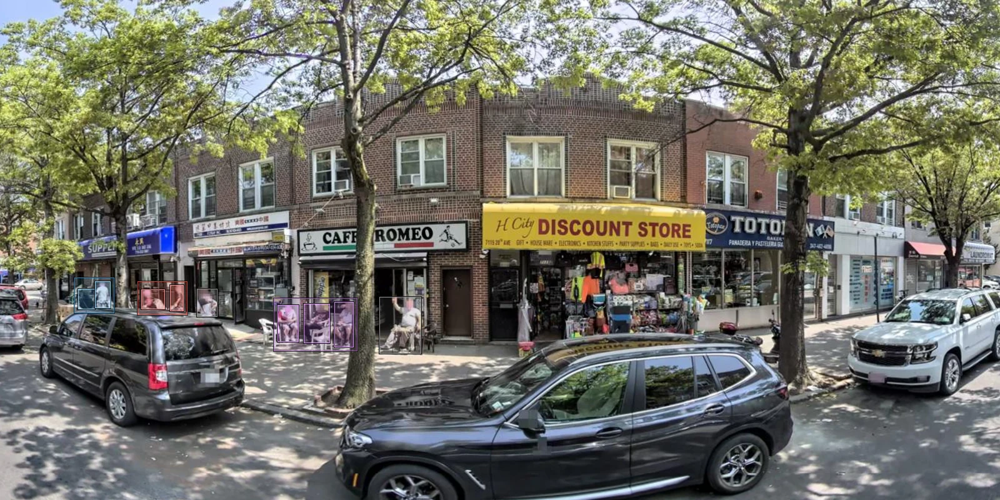
  </a>
  <figcaption><strong>N = 9.</strong> Groups and people standing or seated.</figcaption>
</figure>
</div>
<div class="count-pair" role="group" aria-label="Comparison 2">
<figure>
  <a class="lightbox" href="sdi_low2.webp" data-gallery="count-pairs" data-title="Pair 2, left: N = 9. People on their own, mainly passing through.">
    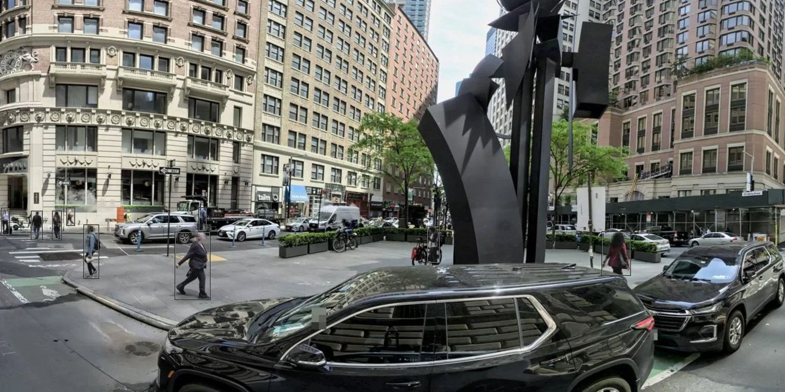
  </a>
  <figcaption><strong>N = 9.</strong> People on their own, mainly passing through.</figcaption>
</figure>
<figure>
  <a class="lightbox" href="sdi_high2.webp" data-gallery="count-pairs" data-title="Pair 2, right: N = 10. A group of four, a pair, and four people alone.">
    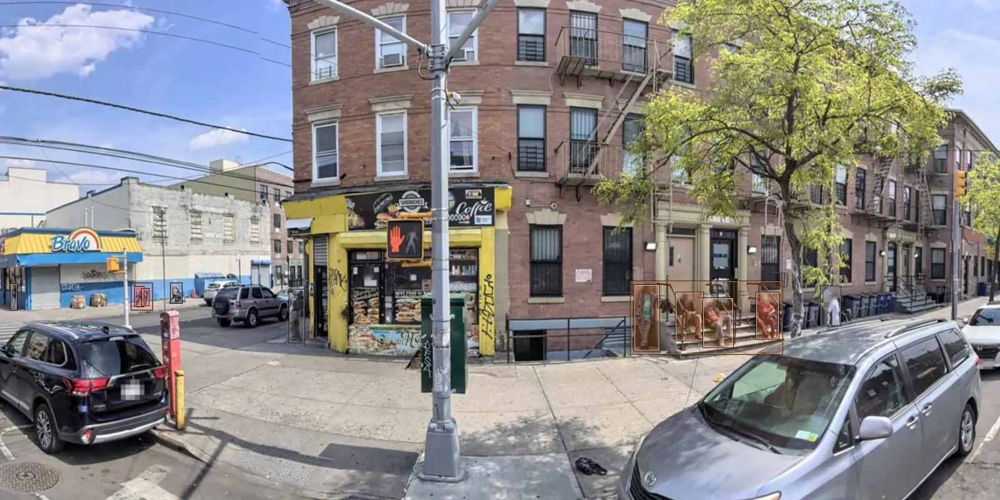
  </a>
  <figcaption><strong>N = 10.</strong> A group of four, a pair, and four people alone.</figcaption>
</figure>
</div>
<div class="count-pair" role="group" aria-label="Comparison 3">
<figure>
  <a class="lightbox" href="sdi_low3.webp" data-gallery="count-pairs" data-title="Pair 3, left: N = 9. People on their own, mainly passing through.">
    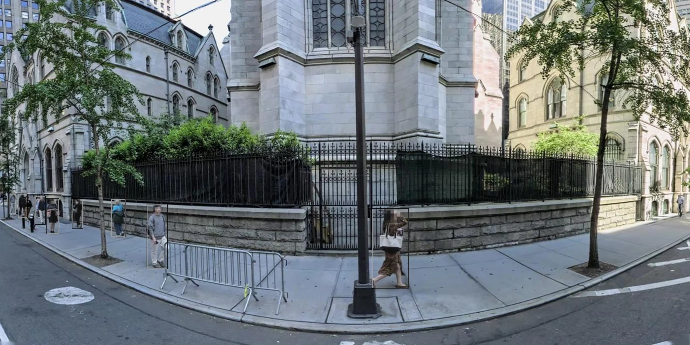
  </a>
  <figcaption><strong>N = 9.</strong> People on their own, mainly passing through.</figcaption>
</figure>
<figure>
  <a class="lightbox" href="sdi_high3.webp" data-gallery="count-pairs" data-title="Pair 3, right: N = 10. Several pairs; most people are stationary.">
    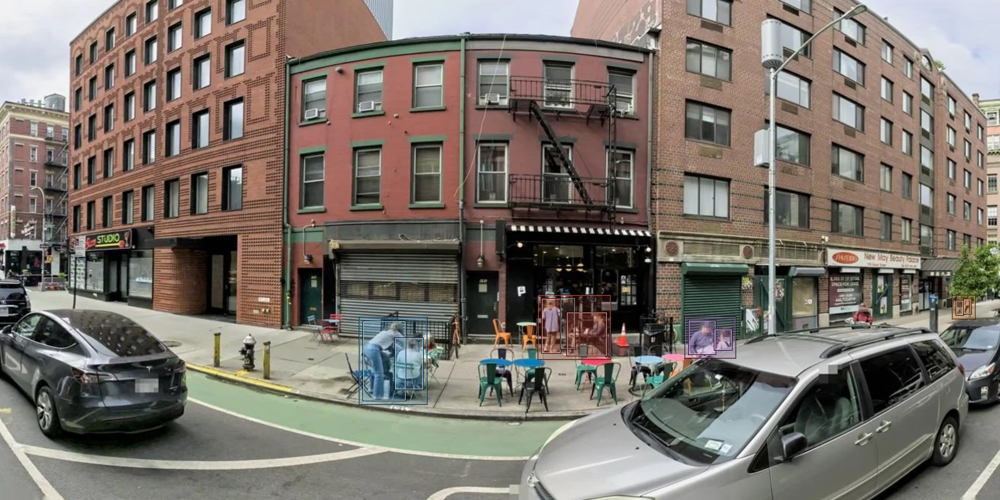
  </a>
  <figcaption><strong>N = 10.</strong> Several pairs; most people are stationary.</figcaption>
</figure>
</div>
</div>
```

These examples are from Figure 8 of [*A Vision-Language Framework for Measuring Social Life on Sidewalks*](https://arxiv.org/abs/2609.28476) (M10; under review).

# What people do on sidewalks {#activities}

These activities appear in street-level images; many would be missed by a pedestrian count or an object detector alone.

```{=html}
<div class="activity-collage" role="group" aria-label="Everyday sidewalk activities, from the first activity collage">
<div class="activity-row" style="--activity-columns:346fr 412fr 509fr 554fr;">
<figure>
  <span class="activity-crop" style="--source-w:1876; --crop-x:0; --crop-y:0; --crop-w:346; --crop-h:384;">
    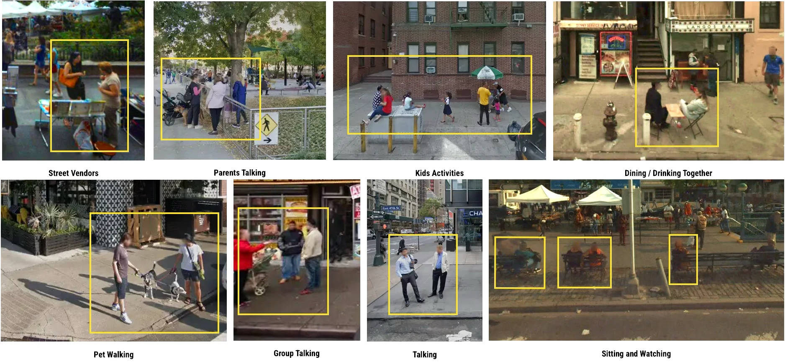
  </span>
  <figcaption>Street vending</figcaption>
</figure>
<figure>
  <span class="activity-crop" style="--source-w:1876; --crop-x:367; --crop-y:0; --crop-w:412; --crop-h:384;">
    
  </span>
  <figcaption>Talking beside strollers</figcaption>
</figure>
<figure>
  <span class="activity-crop" style="--source-w:1876; --crop-x:796; --crop-y:0; --crop-w:509; --crop-h:384;">
    
  </span>
  <figcaption>Children's activities</figcaption>
</figure>
<figure>
  <span class="activity-crop" style="--source-w:1876; --crop-x:1321; --crop-y:0; --crop-w:554; --crop-h:384;">
    
  </span>
  <figcaption>Dining and drinking together</figcaption>
</figure>
</div>
<div class="activity-row" style="--activity-columns:542fr 304fr 277fr 706fr;">
<figure>
  <span class="activity-crop" style="--source-w:1876; --crop-x:0; --crop-y:430; --crop-w:542; --crop-h:387;">
    
  </span>
  <figcaption>Walking dogs</figcaption>
</figure>
<figure>
  <span class="activity-crop" style="--source-w:1876; --crop-x:557; --crop-y:430; --crop-w:304; --crop-h:387;">
    
  </span>
  <figcaption>Talking in a group</figcaption>
</figure>
<figure>
  <span class="activity-crop" style="--source-w:1876; --crop-x:877; --crop-y:430; --crop-w:277; --crop-h:387;">
    
  </span>
  <figcaption>Talking on the sidewalk</figcaption>
</figure>
<figure>
  <span class="activity-crop" style="--source-w:1876; --crop-x:1168; --crop-y:430; --crop-w:706; --crop-h:387;">
    
  </span>
  <figcaption>Sitting and watching</figcaption>
</figure>
</div>
</div>
<div class="activity-collage" role="group" aria-label="Further sidewalk activities, from the second activity collage">
<div class="activity-row" style="--activity-columns:706fr 223fr 414fr;">
<figure>
  <span class="activity-crop" style="--source-w:1876; --crop-x:0; --crop-y:0; --crop-w:706; --crop-h:374;">
    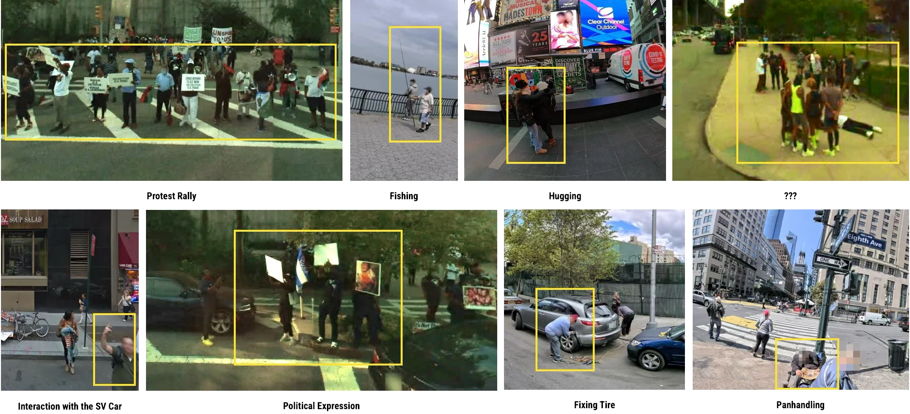
  </span>
  <figcaption>Protest rally</figcaption>
</figure>
<figure>
  <span class="activity-crop" style="--source-w:1876; --crop-x:721; --crop-y:0; --crop-w:223; --crop-h:374;">
    
  </span>
  <figcaption>Fishing</figcaption>
</figure>
<figure>
  <span class="activity-crop" style="--source-w:1876; --crop-x:959; --crop-y:0; --crop-w:414; --crop-h:374;">
    
  </span>
  <figcaption>Hugging</figcaption>
</figure>
</div>
<div class="activity-row" style="--activity-columns:286fr 725fr 373fr 447fr;">
<figure>
  <span class="activity-crop" style="--source-w:1876; --crop-x:0; --crop-y:432; --crop-w:286; --crop-h:374;">
    
  </span>
  <figcaption>Interaction with the street-view vehicle</figcaption>
</figure>
<figure>
  <span class="activity-crop" style="--source-w:1876; --crop-x:301; --crop-y:432; --crop-w:725; --crop-h:374;">
    
  </span>
  <figcaption>Political expression</figcaption>
</figure>
<figure>
  <span class="activity-crop" style="--source-w:1876; --crop-x:1040; --crop-y:432; --crop-w:373; --crop-h:374;">
    
  </span>
  <figcaption>Fixing a tire</figcaption>
</figure>
<figure>
  <span class="activity-crop" style="--source-w:1876; --crop-x:1428; --crop-y:432; --crop-w:447; --crop-h:374;">
    
  </span>
  <figcaption>Seated with belongings</figcaption>
</figure>
</div>
</div>
```

Faces are blurred in the source images, and no individual is identified.

These examples define the measurement problem: finding people is only the first step. To study sidewalk life, we also need to describe how people are together, what they are doing, and where and when they were observed.

# How observations become measures {#how-it-works}

<span id="the-dissertation-method-findings-data" class="anchor-alias" aria-hidden="true"></span>
<span id="method-a-vision-language-framework-for-measuring-social-life-on-sidewalks" class="anchor-alias" aria-hidden="true"></span>

The method connects human observation with image-based measurement. Human judgments about whether pairs of people are together provide training examples for [MINGLE](../mingle/), published at AAAI 2026. My [method paper](https://arxiv.org/abs/2609.28476) extends that approach by combining social-group detection with per-person coding, then turning their outputs into interpretable measures. The paper, coauthored with Andres Sevtsuk, is under review at *Computers, Environment and Urban Systems*.

{fig-alt="Five-stage workflow showing street panoramas reprojected into sideviews, parallel group and per-person attribute detection, validity filtering and cross-branch refinement, indicator construction, and New York City maps." loading="lazy"}

## Recognize social groups {#identify-social-groups}

A social group is a relationship among people, so proximity alone is insufficient. Occlusion, depth differences, and the lack of motion in a still image make it difficult to distinguish people together from people who happen to be close. The framework detects people with **SAM3**, estimates depth with **PatchFusion**, and uses a fine-tuned **Qwen2.5-VL-3B** model to judge pairs before assembling them into groups. The preprint reports **F1 = 80.64%** for this pairwise model, using an expanded **76K training corpus**.

## Describe visible states {#code-each-persons-visible-attributes}

Alongside grouping, **Qwen3-VL-30B-A3B-Instruct** records ten fields per person: validity, posture, locomotion, object, object relation, support surface, zone type, uniform presence, apparent age group, and model-perceived sex. Separating these fields lets a person be recorded as walking, holding a phone, and occupying a particular part of the sidewalk, rather than forcing the observation into a single activity label. The preprint reports **88.5% mean field accuracy on 999 held-out samples**.

The vocabulary draws on Whyte and Mehta's observational research. It distinguishes visible states from interpretations of intent or social meaning. Apparent age and model-perceived sex are exploratory estimates; sex is excluded from primary analyses because provider face blurring makes it unreliable.

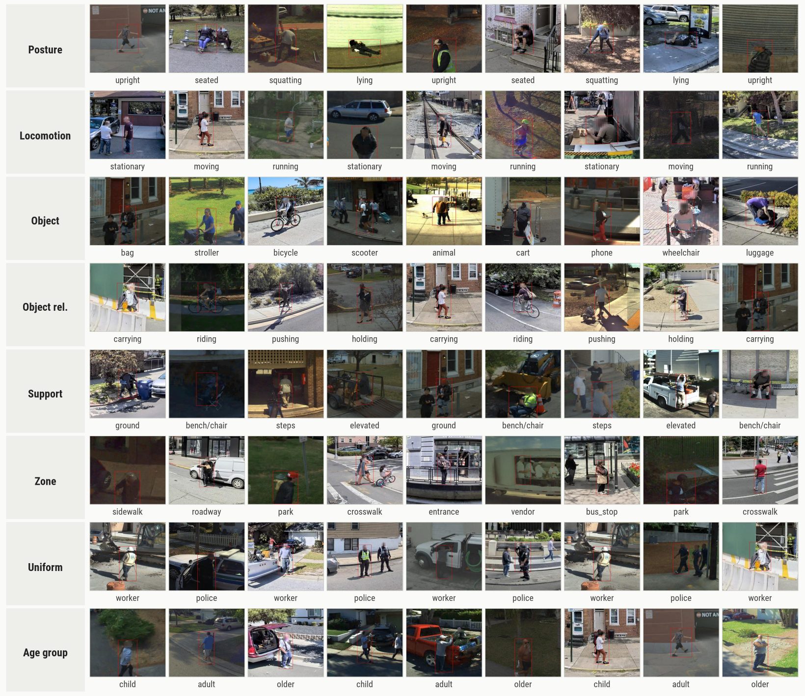{fig-alt="A grid of street-image examples organized by eight attribute fields, illustrating seated and moving people, objects such as strollers and bicycles, and sidewalk contexts." loading="lazy"}

## Connect groups and activities {#refine-and-combine-the-two-branches}

The two branches inform one another. A validity filter removes detections in advertisements, inside vehicles, or outside the target pedestrian space before groups are rebuilt. Group-level consistency helps refine locomotion labels; group IDs then join to the per-person fields. Rules applied to these records produce activity, spatial-context, and accessibility-related indicators, with location and capture time retained for every observation.

## Build interpretable measures {#build-interpretable-measures}

Grouping and dwelling summarize two aspects of the scenes shown above. Each person receives a grouping weight $\alpha$: **1 when alone, 2 in a pair, and 3 in a group of three or more**. A dwelling weight $\beta$ is **3 for a stationary, seated person who is not riding; 2 for a stationary, non-seated person; and 1 otherwise**.

::: {.measurement-table tabindex="0" role="region" aria-label="Definitions of the three sidewalk activity indices"}
| Index | Definition | What it summarizes |
|---|---|---|
| Weighted Grouping Index (WGI) | $\frac{1}{N}\sum_{i=1}^{N}\alpha_{g(i)}$ | Grouping composition |
| Weighted Dwelling Index (WDI) | $\frac{1}{N}\sum_{i=1}^{N}\beta_{s(i)}$ | Observable dwelling posture |
| Social Dwelling Index (SDI) | $\frac{1}{N}\sum_{i=1}^{N}\alpha_{g(i)}\beta_{s(i)}$ | Grouping and dwelling combined for each person |
:::

SDI averages the per-person products of the two weights, which is why scenes with similar headcounts can differ. These ordinal measures describe visible configurations, rather than the duration of a visit, someone's reasons for being there, or the quality of a social experience. The method paper reports sensitivity checks for alternative weights.

# Connect observations to streets {#align-imagery-with-the-street-network}

These measures become useful for urban research when the visual evidence can be connected to a location and an observation time. The spatial workflow retains that connection from the source panorama to a particular side of a street or an intersection.

## Keep capture time explicit {#capture-time-and-place}

Imagery with capture timestamps is organized into four observation windows: weekday and weekend, each at **12:00–14:00 and 17:00–19:00**. This keeps the observed activity tied to when it occurred. The broader collection includes Apple Look Around, Bing Streetside, and Mapillary; the national analysis below uses the Apple and Bing subset.

## From panorama to sidewalk-facing views

Each panorama is reprojected into **left and right sidewalk-facing views**, with a **150° field of view** and a **1600 × 800 pixel frame**. The original presentation figure links the two photographs to the capture point, road direction, and opposite viewing directions on the street network, preserving which side of the street each image observes.

<figure class="slide6-figure">
  <a class="lightbox slide6-crop" href="page6_spatial_overview.jpg" data-gallery="page6-spatial" data-title="Spatial workflow and collection overview from my dissertation presentation. Current data-paper scope is described below." style="--crop-x:20; --crop-y:275; --crop-w:1260; --crop-h:316;">
    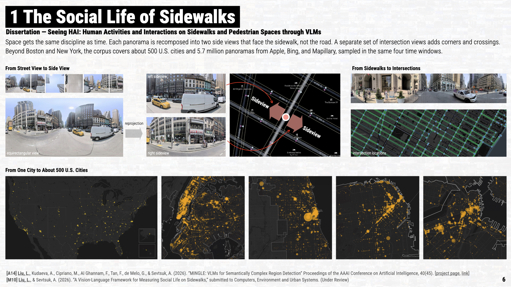
  </a>
  <figcaption>From street view to side view: the red arrows connect the two photographs to their sidewalk-facing directions on the road network. Click to view the full presentation figure.</figcaption>
</figure>

## Keep intersections distinct {#from-sidewalks-to-intersections}

At intersections, a wide view retains corners and crossings together. These records remain separate from mid-block views. For spatial analysis, sidewalk-facing observations are assigned to side-specific block frontages on the **TIGER/Line** road network, while intersection records retain their junction association. View and frontage identifiers, capture time, and a road-segment crosswalk support linkage to land use, transportation, and demographic data.

<figure class="slide6-figure">
  <a class="lightbox slide6-crop" href="page6_spatial_overview.jpg" data-gallery="page6-spatial" data-title="Spatial workflow and collection overview from my dissertation presentation. Current data-paper scope is described below." style="--crop-x:1318; --crop-y:275; --crop-w:586; --crop-h:316;">
    
  </a>
  <figcaption>An intersection panorama and the corresponding collection of intersection locations on the street network. Click to view the full presentation figure.</figcaption>
</figure>

# What counts miss in New York City {#findings-what-kinds-of-streets-support-social-life-in-progress}

Applying the framework to **102,514 New York City sideviews** makes the distinction in the opening examples visible across the city: pedestrian count and SDI have a weak image-level correlation (**r = 0.168**). Mapping their standardized difference shows where relatively high counts coincide with less grouping and dwelling, and where the reverse occurs.

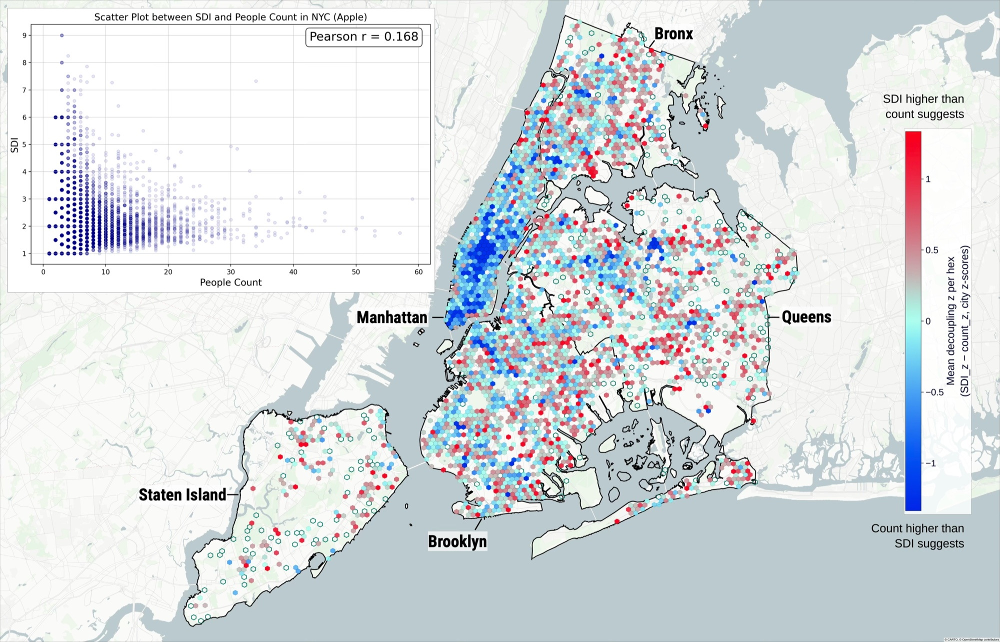{fig-alt="New York City map comparing standardized pedestrian count with the Social Dwelling Index; blue indicates relatively higher counts and red relatively higher SDI." loading="lazy"}

This motivates the dissertation's ongoing **Findings** study: which street environments are associated with grouping and dwelling, alongside foot traffic? Preliminary block-frontage models examine sociodemographic context, street design, and land use. Factors associated with higher counts are not consistently associated with more grouping or dwelling. This work remains in progress; the associations are descriptive and sensitive to imagery coverage, model uncertainty, and spatial dependence.

# From one city to 496 {#data-stay-together-496-u.s.-cities}

The next step asks whether these forms of observed sidewalk life can be studied across cities. *Stay Together: Street-Level Social Indicators for Sidewalk Life Across 496 U.S. Cities*, coauthored with Andres Sevtsuk, develops that national research resource. The manuscript is **in preparation**.

The assembled panel contains **7,139,672 timestamped views** from Apple Look Around and Bing Streetside across **496 U.S. cities**, captured during **2011–2025**. Its **5,692,332 sidewalk-facing views** are organized into **3,725,328 block frontages**. A separate file retains **1,447,340 intersection views** as individual observations. Shared identifiers and a crosswalk to TIGER/Line road segments allow researchers to link observations to other spatial data.

<figure class="slide6-figure">
  <a class="lightbox slide6-crop" href="page6_spatial_overview.jpg" data-gallery="page6-spatial" data-title="Spatial workflow and collection overview from my dissertation presentation. Current data-paper scope is described below." style="--crop-x:20; --crop-y:662; --crop-w:1884; --crop-h:315;">
    
  </a>
  <figcaption>From one city to a national corpus: imagery coverage at national and city scales. Click to view the full presentation figure.</figcaption>
</figure>

The presentation maps document collection coverage, while the counts above describe the data paper's analytical subset. Mapillary imagery is excluded from that analysis and the planned release of indices: its uncontrolled capture geometry prevented almost all of those images from being assigned to block frontages.

## Compare like with like

The national analysis examines **grouping (WGI)** and **visible posture and locomotion (WDI)** separately. SDI is included in the planned release but not used in this paper's empirical analysis. Comparisons must also account for crowd size: a view containing one person necessarily has WGI = 1, so pooling different person counts can reverse an apparent association with neighborhood density.

Holding the detected count at **exactly two people**, the share classified as one group falls from **38.0% in the lowest tract-density quintile to 26.8% in the highest**. This descriptive pattern demonstrates the importance of the comparison being made; it does not establish that density causes less socializing.

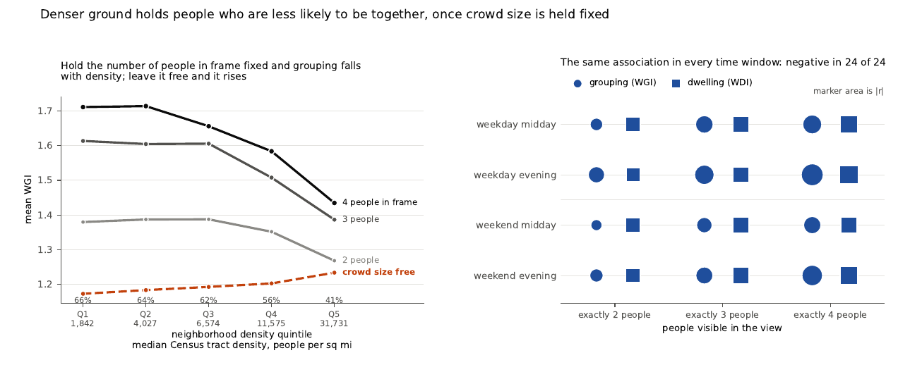{fig-alt="Two-panel analysis showing mean WGI across density quintiles at fixed person counts, alongside negative correlations of density with WGI and WDI within each person-count and time-window combination." loading="lazy"}

## Build a research resource with explicit limits

The national maps summarize grouping and dwelling where the imagery supports measurement. People were detected on **430,984 frontages (11.6%)**; grouping and dwelling are undefined on the rest. The median frontage has one view. Coverage is opportunistic, and the national sample has not received an independent annotation audit, so these records support research on observed configurations rather than validated rankings of places.

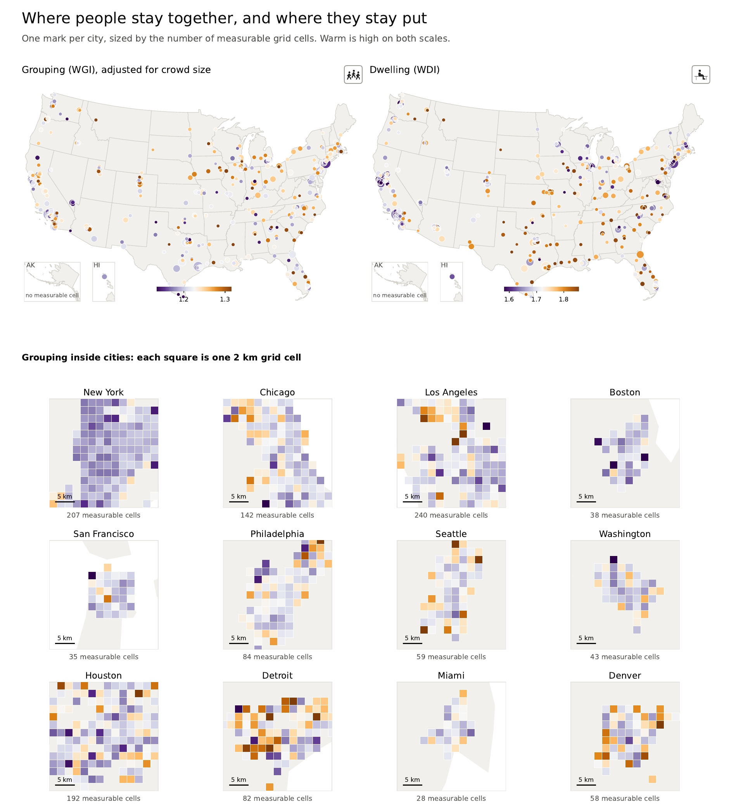{fig-alt="National maps of grouping and dwelling across measurable 2-kilometer grid cells, with detailed grouping maps for twelve selected cities." loading="lazy"}

The panel is assembled and in use. **Derived tables, schemas, and documentation are being prepared for public release**; source imagery will not be redistributed.

# Inspect the evidence {#the-great-streets-visualization}

The final connection is back to the images. *The Great Streets* prototype lets a user move from segment-level indicators in a 3D map to the source views and person-level labels. Comparing observations across sources and times makes it possible to trace a mapped value back to the visible evidence from which it was constructed.

<figure class="project-video-figure">
  <video controls playsinline preload="metadata" poster="great_streets_poster.jpg" aria-label="Screen recording of The Great Streets visualization">
    <source src="great_streets_visualization.mp4" type="video/mp4">
    Your browser does not support embedded video.
  </video>
  <figcaption>Screen recording of the prototype using New York City data. The interface links segment-level indicators, 3D context, source imagery, and visual labels.</figcaption>
</figure>

[More project visualizations](../../visualization/#project-visualizations).

# Dissertation and related work {#papers-and-links}

## Research development {#how-this-research-came-together}

The questions grew from [*Clarity or Confusion*](../clarity/), my *Cities* (2024) review of 104 street attributes across 146 papers, which found few measures of human activities and interactions. [MINGLE](../mingle/) provided a method for detecting social groups. This work also connects with [the City Form Lab collaboration shown at Venice](../sidewalk_ballet/), which I lead at MIT and which brings group detection into a public installation.

<span id="related-material" class="anchor-alias" aria-hidden="true"></span>

- **Method:** [*A Vision-Language Framework for Measuring Social Life on Sidewalks*](https://arxiv.org/abs/2609.28476) · Under review at *Computers, Environment and Urban Systems*.
- **Group detection:** [*MINGLE: VLMs for Semantically Complex Region Detection*](https://doi.org/10.1609/aaai.v40i45.41239) · AAAI 2026 · [Project](../mingle/).
- **National data:** [*Stay Together: Street-Level Social Indicators for Sidewalk Life Across 496 U.S. Cities*](#data-stay-together-496-u.s.-cities) · Manuscript in preparation.
- **Presentations:** [Dissertation colloquium and research talks](../../presentations/).
- **Proposal:** [Approved dissertation proposal (PDF)](https://www.dropbox.com/scl/fi/6b0csugj5mr8n1u4bc98u/Dissertation-Research-Proposal-250423_Liu.pdf?rlkey=e3w0m8vrksbr1ewnh8ydruhxv&st=ff0xemho&dl=0) · Password-protected; [email me](mailto:lyons66@mit.edu) for access.
- **Publications:** [Full publication list](../../papers/).
- **Contact:** [lyons66@mit.edu](mailto:lyons66@mit.edu).

```{=html}
<script>
(() => {
  function positionAnchorHeading() {
    let id;
    try { id = decodeURIComponent(window.location.hash.slice(1)); }
    catch { return; }
    const target = id && document.getElementById(id);
    if (!target) return;
    const section = target.classList.contains('anchor-alias') ? target.closest('section') : target;
    const heading = section && section.querySelector(':scope > h1, :scope > h2, :scope > h3, :scope > h4');
    const landing = heading || target;
    requestAnimationFrame(() => requestAnimationFrame(() => landing.scrollIntoView({block: 'start'})));
  }
  document.addEventListener('DOMContentLoaded', positionAnchorHeading);
  window.addEventListener('load', positionAnchorHeading);
  window.addEventListener('hashchange', positionAnchorHeading);
})();
</script>
```
