```{=html}
<style>
.quarto-title-banner {
  background-position: 50% 50%;
  height: 200px;
}
</style>
```

::: {.callout-note .project-context}
## Project context

**CitoryTech product development and commissioned application for Daimler Innovation Lab**<br>
**My role:** Project lead. StreeTalk began as a routing prototype in **2016** and was adapted for Daimler in **2018**. The workflow connected street imagery and human judgments to perceived-safety scores and pedestrian route alternatives. Related research appeared in [*Landscape and Urban Planning*](../../papers/#urban-perceptions) and [*Landscape Architecture Frontiers*](../../papers/#streetalk).
:::

# Project question {#the-idea}
In 2016, after moving to a new apartment in Shanghai, I followed an Amap walking route that passed deteriorated pavement, limited lighting, and long blank walls. That experience motivated a question: could pedestrian navigation account for the visual experience of a route as well as its distance?

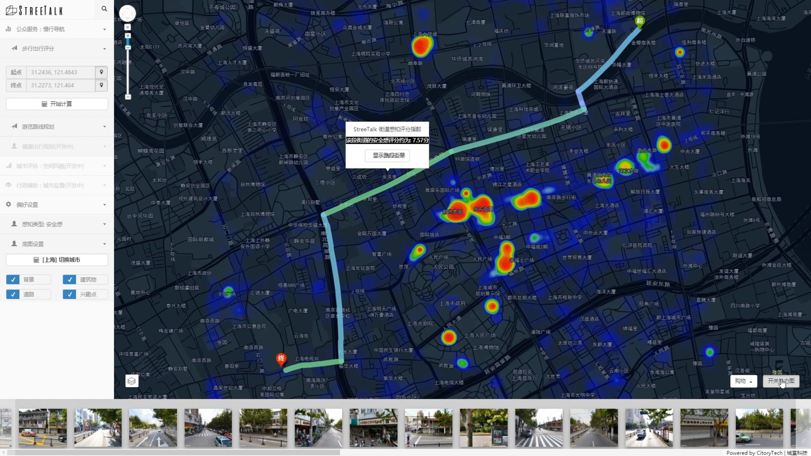{fig-alt="StreeTalk perception-aware pedestrian routing overview." loading="lazy"}

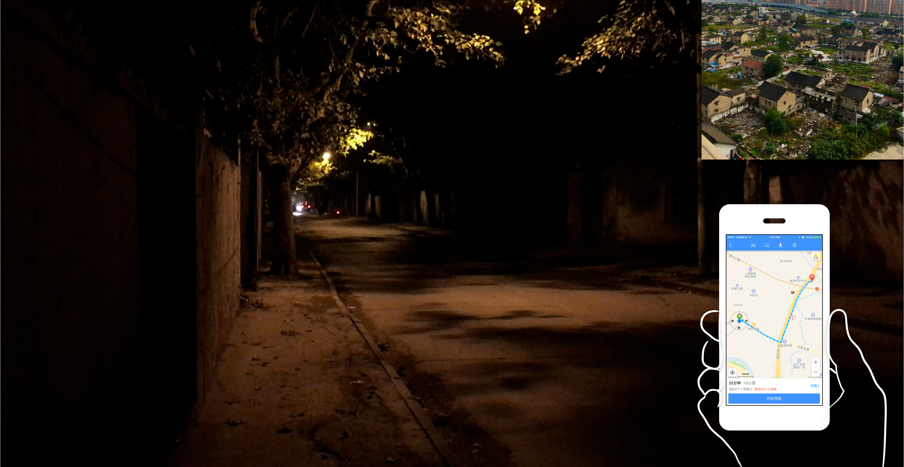{fig-alt="Street environments compared in the original StreeTalk route example." loading="lazy"}

# Modeling perceived street safety {#modeling-perceived-street-safety}
I trained a street-view classifier to estimate perceived-safety scores and used its outputs to build a citywide perception map of Shanghai. The resulting software connected image-based scores to street segments, creating the spatial layer required for perception-aware pedestrian routing.

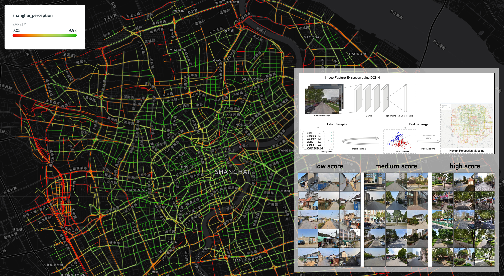{fig-alt="StreeTalk street-safety map and routing interface." loading="lazy"}

# Demonstration {#demo-video}
Below is a demo video showing how the perceived-safety score is applied for pedestrian routing.



[Explore more project visualizations](../../visualization/#project-visualizations).


# Dataset and model development {#revisit-the-dataset-and-algorithm}
The following sections document a later technical revisit of the perception datasets and modeling workflow used in this line of research.

## Place Pulse 2.0

A significant source of street perception data is the ["Place Pulse" project](https://centerforcollectivelearning.org/urbanperception). It collects public feedback on various urban areas using a pairwise labeling interface. Initiated in 2010, the project's website showcases roughly 4,000 images from four cities: Boston, New York, Linz, and Salzburg. As shown in Figure 1, it gauges public perception across six dimensions. Participants are presented with pairs of street views and asked, "Which image looks safer?"

Over the years, the dataset was enhanced to version 2.0, which includes 110,998 random street-view images gathered from 56 cities in 28 countries across six continents. From 2013 to 2016, 81,630 online participants took part in the survey, providing over 1,170,000 pairwise comparisons. Its geographic and participant coverage made it a useful large-scale benchmark for studying perceived qualities of urban scenes, while still requiring care when transferring models across local contexts.

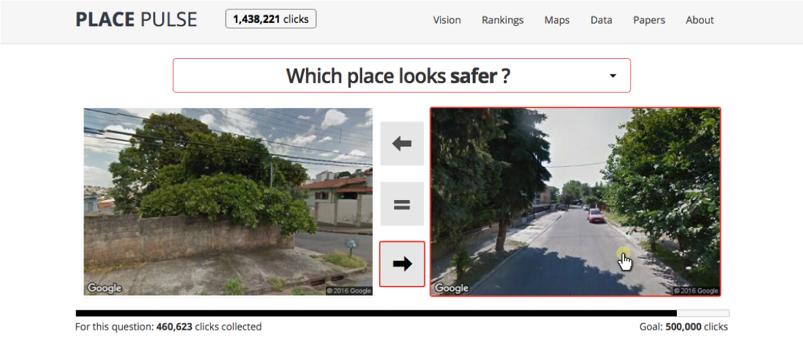{fig-alt="Place Pulse street-image comparison interface." loading="lazy"}

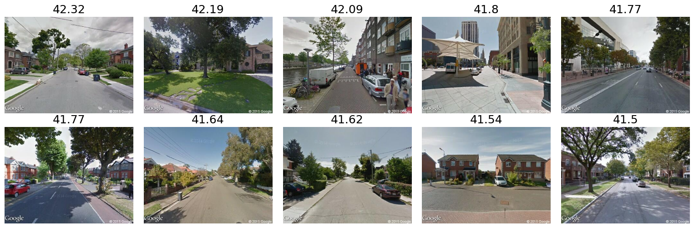{width=100%}

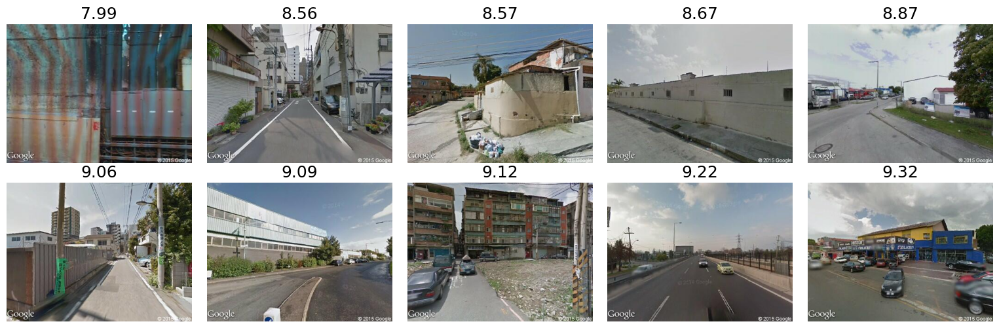{width=100%}

## Binary SVM baseline {#binary-svm-for-baseline-measurement}

As a baseline, I trained binary support vector machine classifiers for the six perception dimensions and compared their predictive accuracy. The accuracy results for all six models are shown below.

::: {.project-figure-pair}
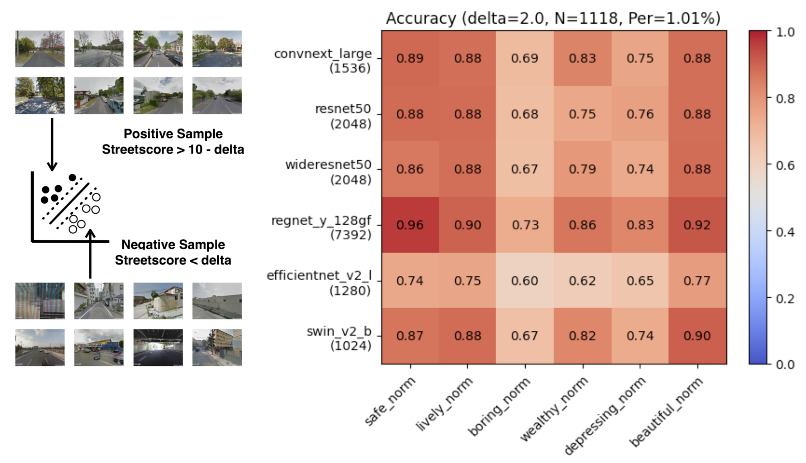{fig-alt="First panel of binary SVM perception-classification results." loading="lazy"}

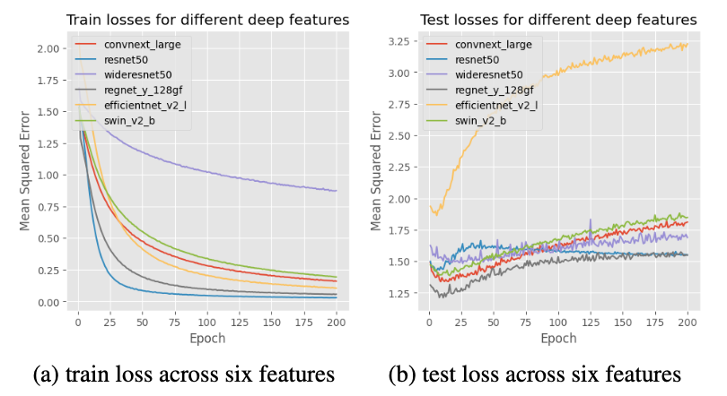{fig-alt="Second panel of binary SVM perception-classification results." loading="lazy"}
:::

## Class activation maps {#class-activation-maps-for-street-view-images}

Class activation maps provide a visual diagnostic of the image regions contributing to positive and negative model predictions. They help inspect model attention, but should not be treated as direct evidence of human attention or causal environmental effects. Below are negative and positive samples from the updated models.

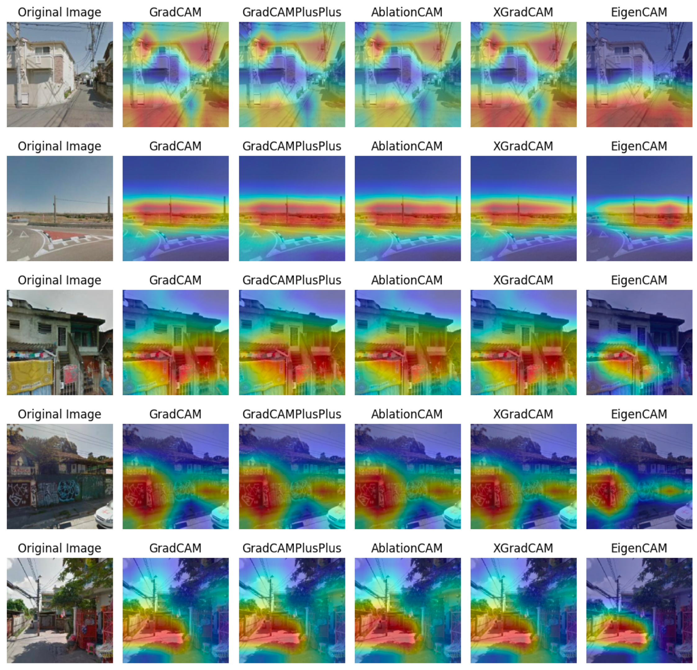{width=100%}

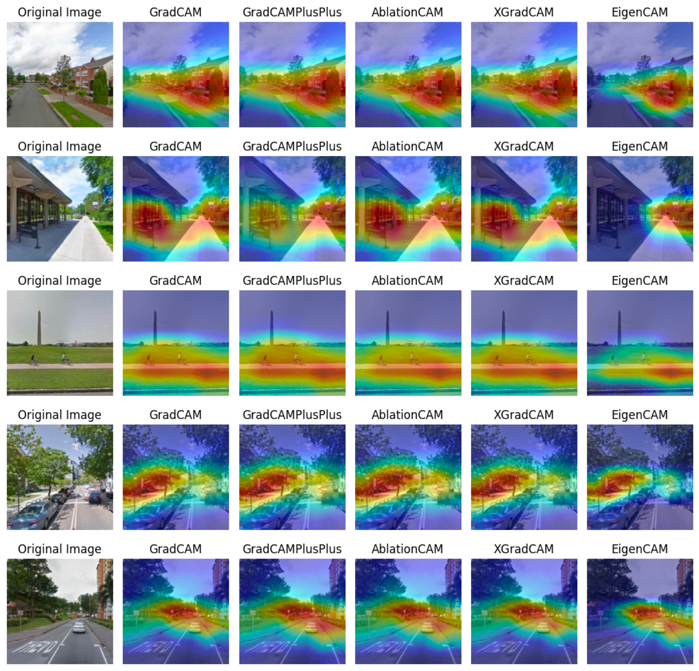{width=100%}

# Commissioned application for Daimler {#collaboration-with-daimler}

In 2018, the project delivered perceived-safety maps for more than 300 cities in China for a Daimler Innovation Lab application. The spatial scores supported pedestrian route alternatives that considered both network distance and modeled street perception.

As part of client validation, Daimler supplied a set of non-standard test images, including scenes outside the street-view conditions represented in the training data. The model's response to these images, including a nighttime scene, helped the team discuss generalization limits and increased the client's confidence in proceeding with the commissioned application. This exercise was an applied validation step, not a substitute for systematic out-of-distribution evaluation.

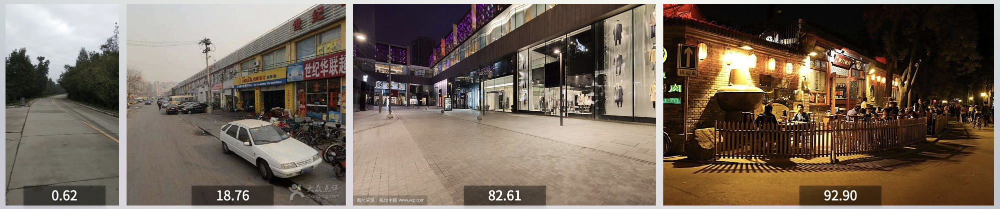{width=100%}

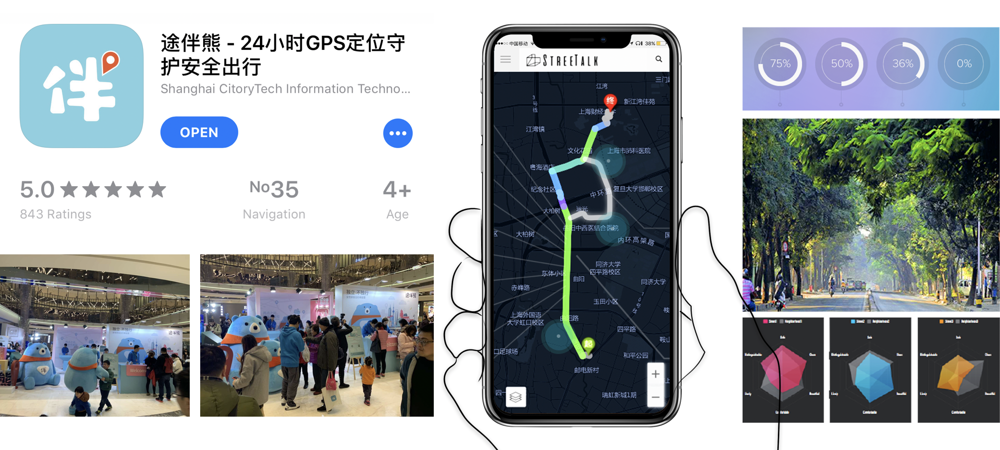{width=100%}

# Publications

- Zhang, F., Zhou, B., Liu, L., Liu, Y., Fung, H. H., Lin, H., & Ratti, C. **Measuring Human Perceptions of a Large-Scale Urban Region Using Machine Learning.** *Landscape and Urban Planning*. [Paper](https://www.sciencedirect.com/science/article/pii/S0169204618308545) · [Publication entry](../../papers/#urban-perceptions).
- Liu, L., Zhang, F., Zhou, B., Wang, Z., & Li, Y. **StreeTalk: A Navigation System for Pedestrians and Cyclists.** *Landscape Architecture Frontiers*. [Journal](https://oversea.cnki.net/knavi/JournalDetail?pcode=CJFD&pykm=jgsj) · [Publication entry](../../papers/#streetalk).
