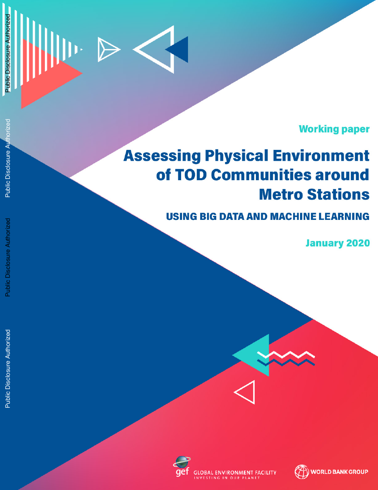
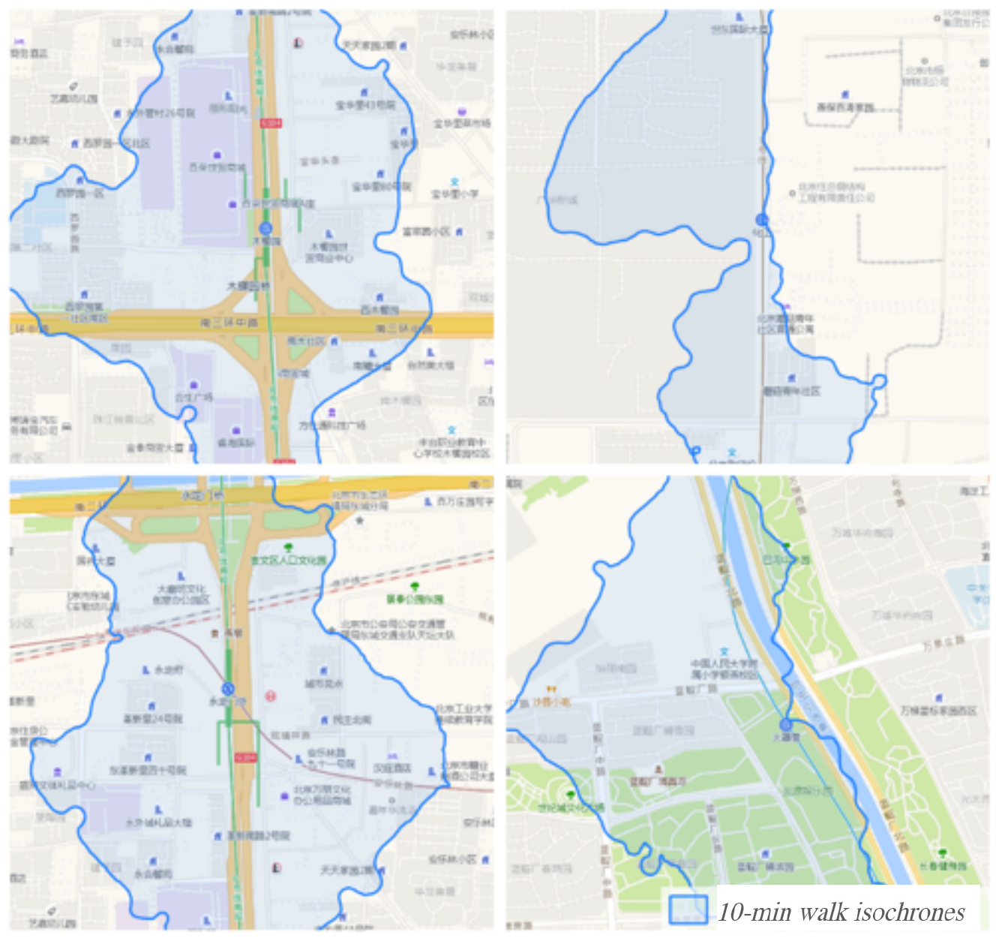
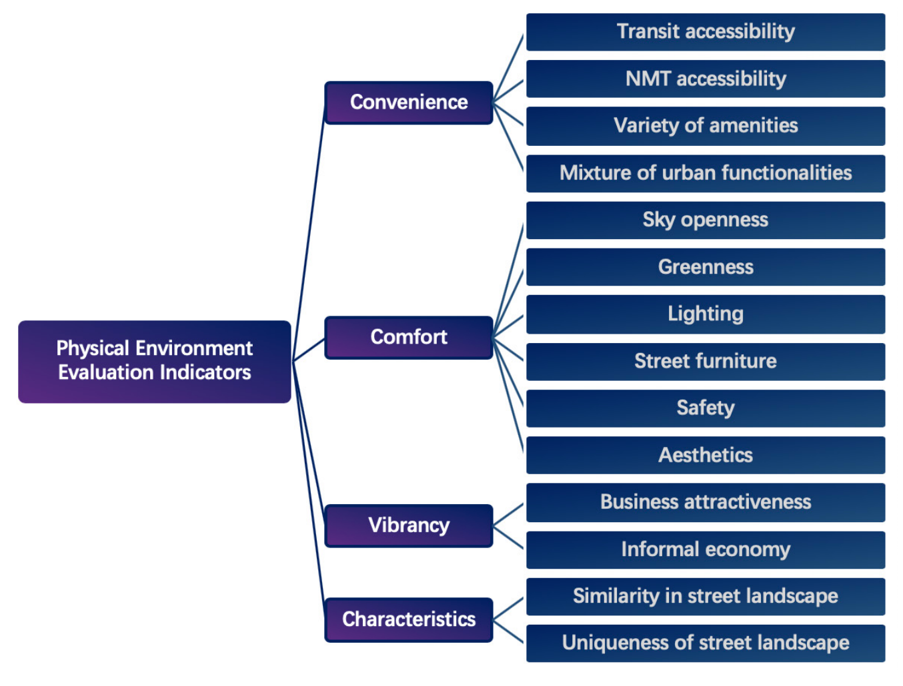
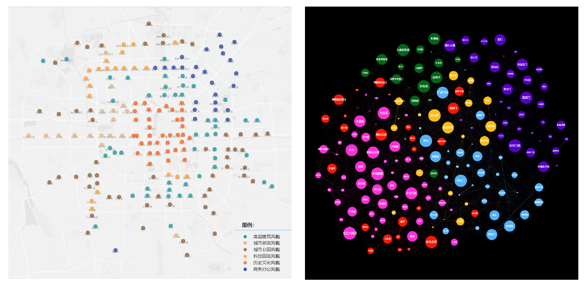
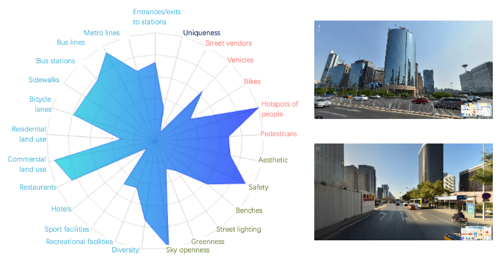

```{=html}
<style>
.quarto-title-banner { --banner-overlay: rgba(0, 0, 0, 0.6); }
</style>
```

::: {.callout-note}
## Project context

**World Bank study · Beijing · CitoryTech project, 2019 · Published January 2020**<br>
My role: CitoryTech project lead and **second author** of the World Bank report.
:::

A metro station can be well connected to the transit network while offering an uncomfortable or inconvenient walk outside its entrances. This project asked how planners could assess those environments consistently across a city. I led CitoryTech's analysis team and coauthored the resulting World Bank working paper with Wanli Fang and Jianhao Zhou.

```{=html}
<div class="tod-publication" role="region" aria-labelledby="tod-publication-title">
  <a class="tod-report-cover" href="https://openknowledge.worldbank.org/entities/publication/6d2172cd-ee09-54e6-8cd9-3119ec32aeb5" aria-label="Read the World Bank publication">
    
  </a>
  <div>
    <p class="tod-publication-label">World Bank Working Paper · January 2020</p>
    <h2 id="tod-publication-title">Assessing Physical Environment of TOD Communities around Metro Stations</h2>
    <p class="tod-report-subtitle">Using Big Data and Machine Learning</p>
    <p>Fang, W., <strong>Liu, L.</strong>, &amp; Zhou, J. (2020). World Bank, Washington, DC.</p>
    <p class="tod-publication-links"><a href="https://openknowledge.worldbank.org/entities/publication/6d2172cd-ee09-54e6-8cd9-3119ec32aeb5">World Bank publication</a><a href="https://documents.worldbank.org/curated/en/433621581930100479/pdf/Assessing-Physical-Environment-of-TOD-Communities-around-Metro-Stations-Using-Big-Data-and-Machine-Learning.pdf">Read PDF</a><a href="https://doi.org/10.1596/33343">DOI</a></p>
  </div>
</div>
```

# Define the pedestrian catchment

The study covered **201 metro stations within Beijing's Fifth Ring Road**, measuring conditions within each station's **10-minute walking catchment**. Rather than applying a fixed-radius buffer, these areas followed the street network, accounting for disconnected streets, major roads, and other barriers.

The resulting walking catchments ranged from **53 to 208 hectares**. That variation is itself useful planning evidence: stations with similar geographic proximity can provide very different access to surrounding neighborhoods.

{fig-alt="Four maps showing irregular ten-minute walking catchments at Beijing metro stations, constrained by major roads, disconnected streets, a river, and green space." width="72%" loading="lazy"}

# Combine access and street experience

Street-view imagery supplied evidence about what pedestrians encounter outside the station. We combined **image recognition**, **models of human visual perception**, and **spatial analysis** with points of interest and transit information. The framework organized this evidence into **four dimensions and 14 indicator groups**.

| Dimension | Evidence examined |
|---|---|
| Convenience | Transit connections, walking and cycling access, amenities, and mixed urban functions |
| Comfort | Sky openness, visible greenery, lighting, seating, and predicted perceptions of safety and aesthetics |
| Vibrancy | Image-based observations of pedestrians, bicycles, vehicles, and street vendors |
| Characteristics | Similarity and uniqueness of station-area streetscapes |

{fig-alt="English-language indicator hierarchy with convenience, comfort, vibrancy, and characteristics branching into fourteen indicator groups." width="88%" loading="lazy"}

# Compare stations in context

For citywide comparison, the report normalized indicators to a common scale and used the Analytic Hierarchy Process to aggregate convenience, comfort, and vibrancy. Streetscape clustering identified **six types of station-area landscapes**, including historic, commercial-office, high-rise, suburban, park, and green urban settings. Aggregation weights varied by landscape type, recognizing that station areas have different contexts.

{fig-alt="Map of Beijing stations colored by six landscape categories beside a network diagram linking visually similar station areas." loading="lazy"}

# Turn profiles into local priorities

Station profiles connected the comparative assessment back to specific streets. At **Guomao**, the report identified strong transit connections, abundant amenities, and high vibrancy, alongside more moderate comfort and limited streetscape distinctiveness. Its proposed improvements included more diverse vegetation, compatible cultural or artistic elements, and a more bicycle-friendly environment.

{fig-alt="Guomao station radar chart with indicators for transit, amenities, greenery, perceptions, and observed activity beside two street-view photographs." loading="lazy"}

The aim was to support **targeted station-area improvements** and a repeatable basis for comparison across stations, corridors, and future surveys. The report presents diagnostic findings and possible interventions; it does not evaluate the effects of implemented changes.

# My contribution and scope

I led the CitoryTech team's work and am the report's second author. The acknowledgements identify me as **Data Scientist (consultant)** and credit the street-view and big-data analysis to Liu Liu, Jinxin Shao, Hongdu Yi, Ding Zhang, Nan Jiang, and Xin Xiong at CitoryTech. The World Bank study was conducted under the GEF Sustainable Cities Integrated Approach Pilot Project (P156507).

The measures describe conditions visible in the sampled imagery. Predicted safety is a visual judgment; people and vehicles detected in an image are observations rather than measured traffic flows. The published assessment focuses on environments **outside** metro stations, with station interiors discussed as future work.

Related work: [CityEye](../cityeye/), CitoryTech's collaborative image-collection tool, and the [Nanjing Livable Neighborhood Assessment](../livable_neighborhoods/), a separate field-survey and image-analysis project.

Figures are cropped from Fang, Liu, and Zhou (2020), © World Bank, under [CC BY 3.0 IGO](https://creativecommons.org/licenses/by/3.0/igo/). The walking-catchment basemaps are credited in the report to Gaode (AMap). Original figure colors, labels, and plotted values are retained. [Publication and full report](https://openknowledge.worldbank.org/entities/publication/6d2172cd-ee09-54e6-8cd9-3119ec32aeb5).
