```{=html}
<style>
.quarto-title-banner {
  background-position: 50% 50%;
  height: 200px;
}
</style>
```
::: {.callout-note .project-context}
## Project context

**CitoryTech commission for Hongkong Land** · West Bund Financial City<br>
**My role:** Project lead, integrating social-media images and comments, points of interest, and spatial analysis into a commercial-district benchmarking system. **Phase I** analyzed approximately **14 million records** from international reference cases; **Phase II** analyzed approximately **7 million records** from Chinese cases. The deliverables informed comparisons of design, tenant strategy, amenities, and operations.
:::

# Project question {#the-idea}
Commercial districts invest heavily in public-space design, temporary installations, events, and amenities, but conventional performance indicators reveal little about which interventions attract attention, encourage visits, or shape public response. VibeScan treats publicly available online comments and images as an additional evidence source for comparing spatial and operational strategies across districts. The aim is not to replace surveys or financial analysis, but to connect observable public response with specific places, facilities, and design decisions.

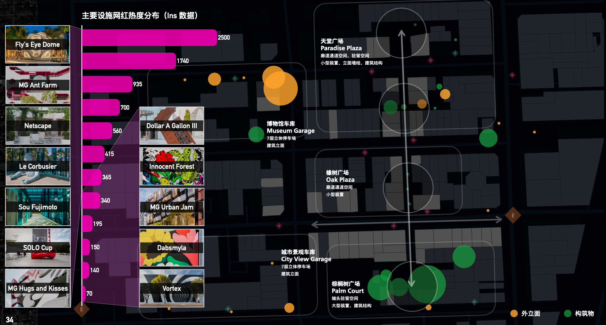{fig-alt="VibeScan commercial-district benchmarking overview." loading="lazy"}

# Data and processing {#data-process}
The workflow collected publicly available comments and user-contributed images from multiple social-media platforms in China and the United States. Records were cleaned, geolocated where possible, and organized around districts, destinations, facilities, events, and recurring topics. Phase I analyzed approximately 14 million records from established international cases; Phase II analyzed approximately 7 million records from recently developed Chinese cases. The project combined text mining, image analysis, point-of-interest data, and spatial comparison to produce district-level benchmarks.

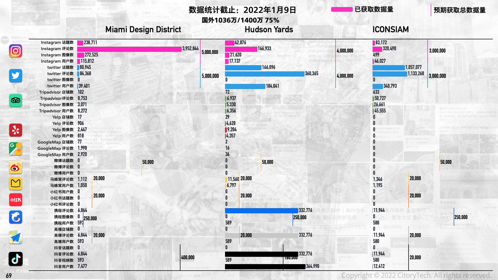{fig-alt="VibeScan data-collection and analytical workflow." loading="lazy"}

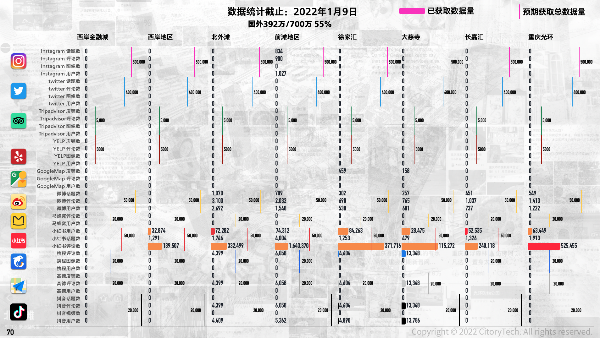{fig-alt="Reference-case data structure in the VibeScan project." loading="lazy"}

# Benchmark comparisons {#key-results}
## Miami Design District {#miami-design-district-benchmark}

### Search interest across platforms {#search-interest-across-platforms}

Search-index trends were compared across Chinese and U.S. platforms to show how much online attention the district attracts on each channel and how that attention changes over time. The comparison shows how the sampled online attention varied across channels and over time.

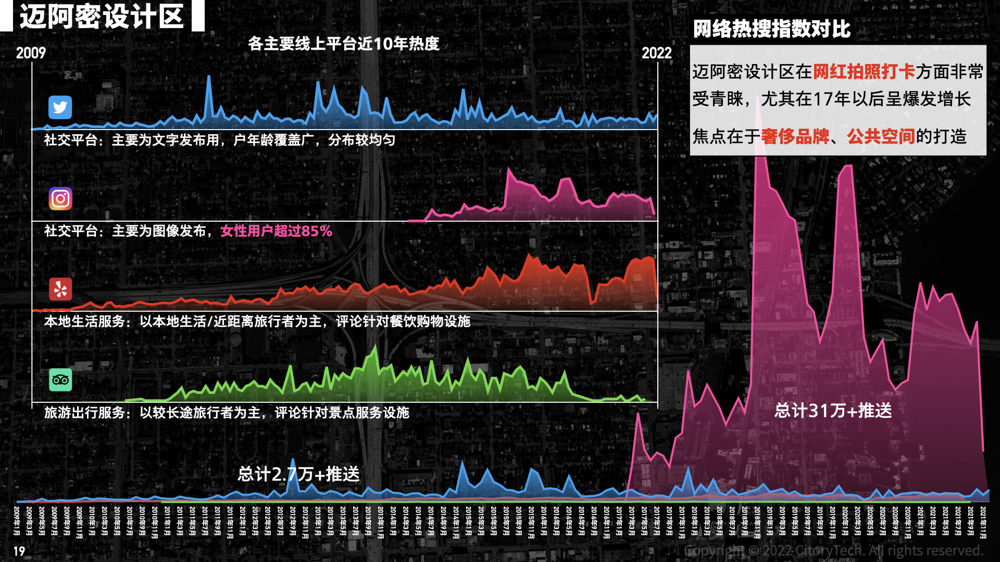{fig-alt="Search-interest comparison for Miami Design District." loading="lazy"}

### Brand and check-in patterns {#brand-and-visitor-check-in-patterns}

Check-in records were organized by brand and over time to compare recorded activity around tenants. These patterns supported discussions of tenant mix and programming, while reflecting the platform's users rather than all visitors.

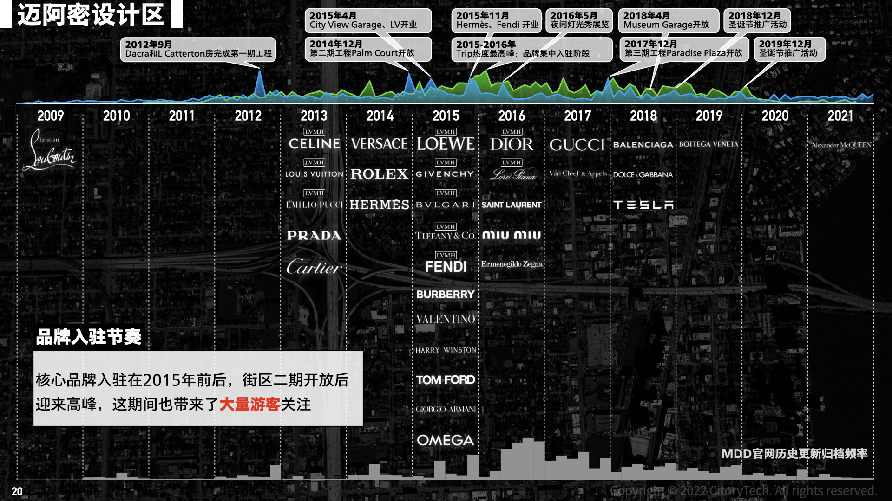{fig-alt="Brand-level check-in patterns for Miami Design District." loading="lazy"}

### Spatial investments and creator attention {#spatial-investments-and-influencer-attention}

These charts relate leading merchants' investments in space and installation design to subsequent check-in and creator/influencer activity. The comparison is descriptive: it shows which spatial investments coincided with online attention, without asserting a causal effect.

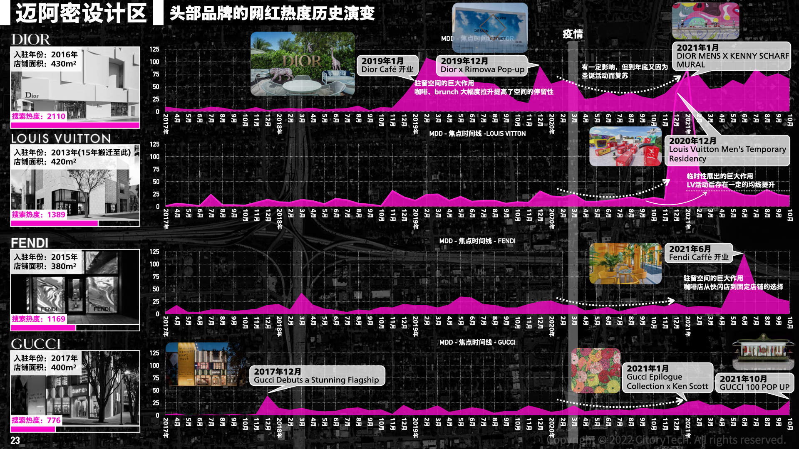{fig-alt="First comparison of spatial investments and online attention in Miami Design District." loading="lazy"}

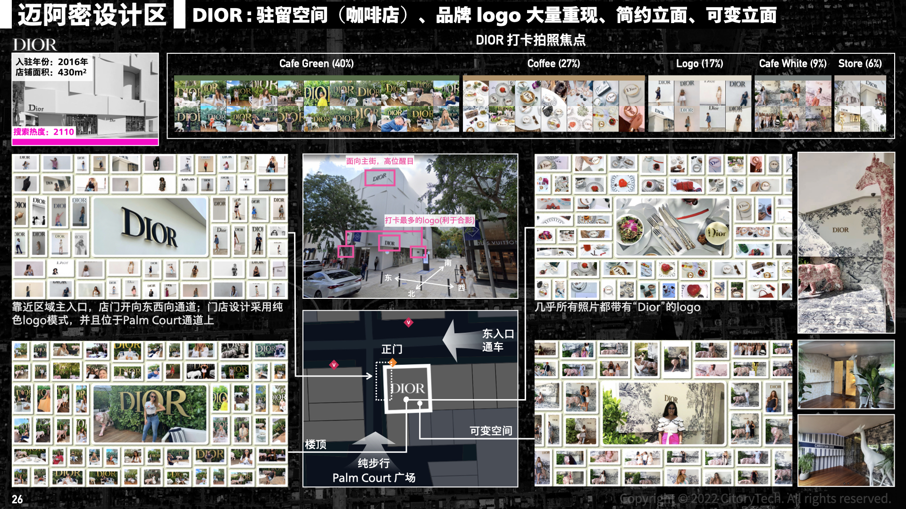{fig-alt="Second comparison of design installations and creator activity in Miami Design District." loading="lazy"}

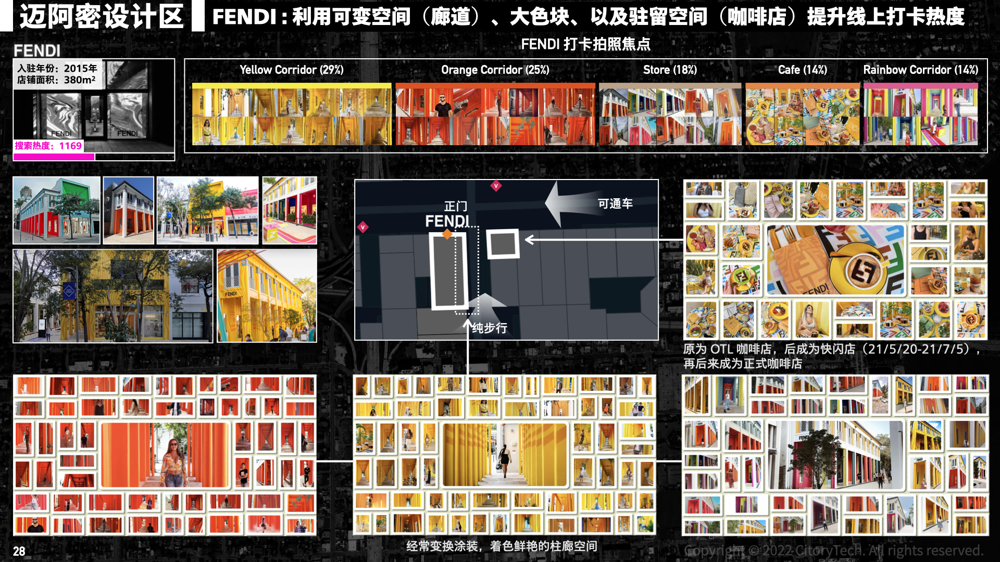{fig-alt="Third spatial benchmarking comparison for Miami Design District." loading="lazy"}

### Public amenities in online records {#use-of-public-amenities}

Comments and images referencing public facilities in the district's main spaces were used to compare how contributors documented and discussed amenities, informing decisions about which facilities merit investment.

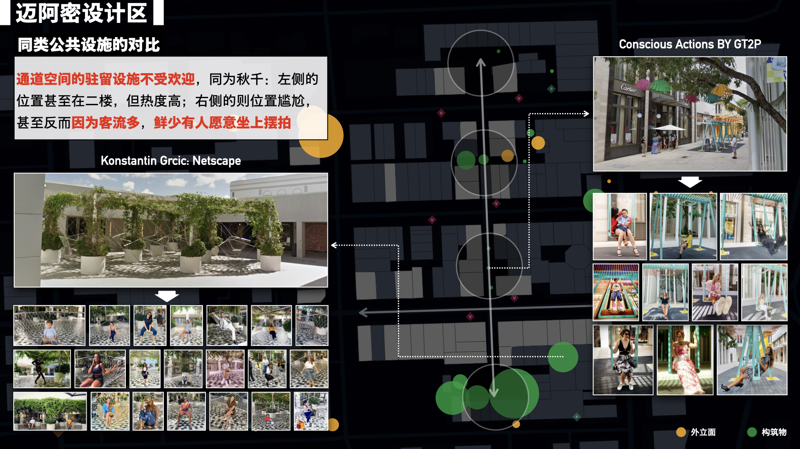{fig-alt="First analysis of public amenities in Miami Design District." loading="lazy"}

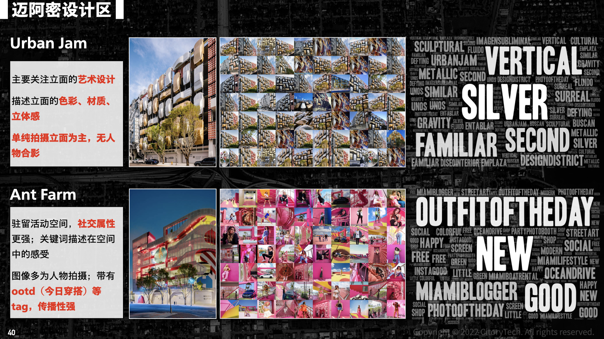{fig-alt="Second analysis of public amenities in Miami Design District." loading="lazy"}

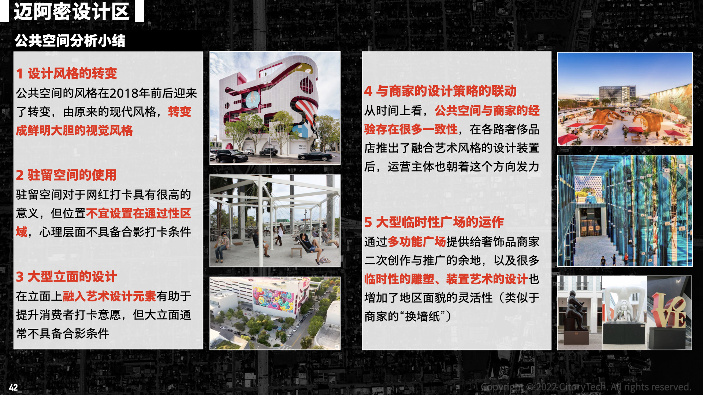{fig-alt="Third analysis of public amenities in Miami Design District." loading="lazy"}

## Hudson Yards {#hudson-yards-benchmark}

### Search interest across platforms {#search-interest-across-platforms-1}

Search-index trends for Hudson Yards were compared across platforms, parallel to the Miami Design District analysis, to benchmark the district's online visibility.

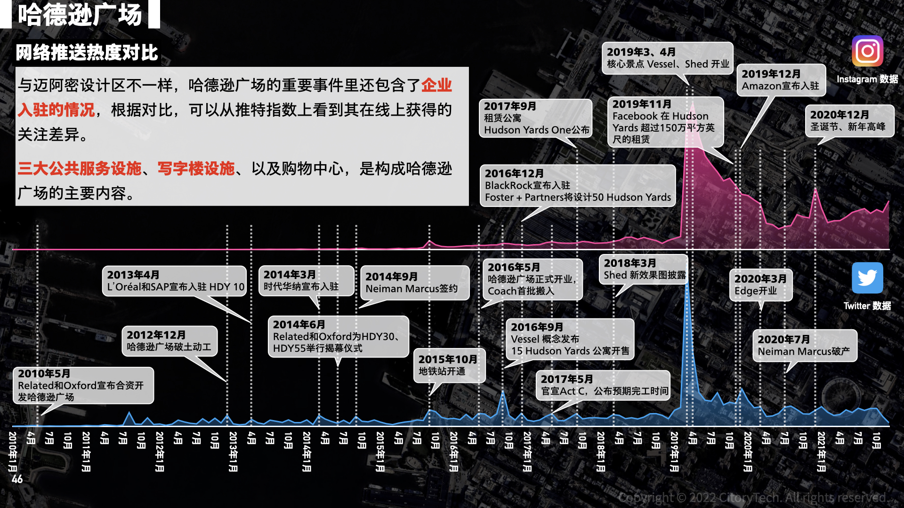{fig-alt="Search-interest comparison for Hudson Yards." loading="lazy"}

### Estimated contributor composition {#estimated-visitor-composition}

Publicly available profile and content signals were used to compare the apparent composition of online contributors. These estimates describe the sampled accounts and do not establish the demographic composition of all visitors.

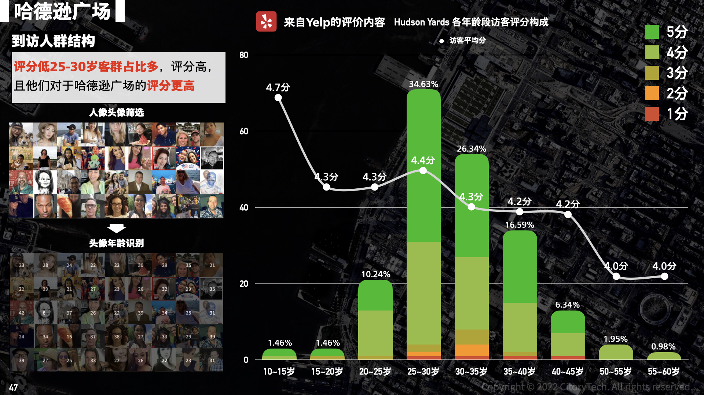{fig-alt="Profile-based estimates for online contributors discussing Hudson Yards." loading="lazy"}

### Public response to Vessel {#public-response-to-vessel}

Comments mentioning Vessel were mined for recurring topics and sentiment, showing how the public responded to the district's signature landmark.

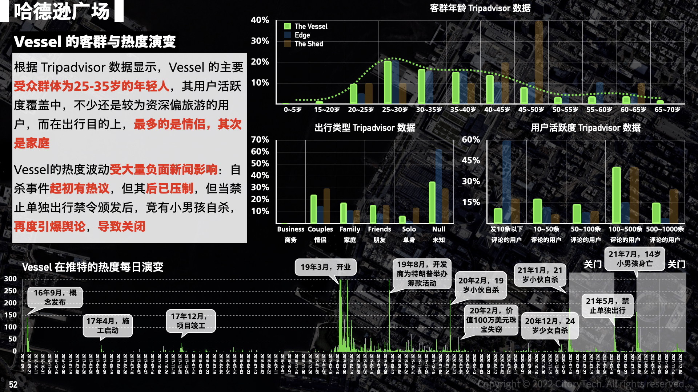{fig-alt="Comment analysis for Vessel at Hudson Yards." loading="lazy"}

### Public response to Edge {#public-response-to-edge}

Comments mentioning the Edge observation deck were analyzed the same way, indicating how a paid attraction contributes to the district's public profile.

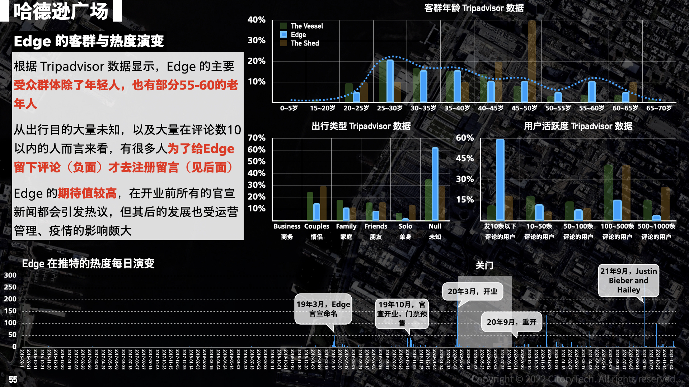{fig-alt="Comment analysis for Edge at Hudson Yards." loading="lazy"}

### Public response to The Shed {#public-response-to-the-shed}

Comments mentioning The Shed were analyzed to show how a cultural venue shapes public response to the district.

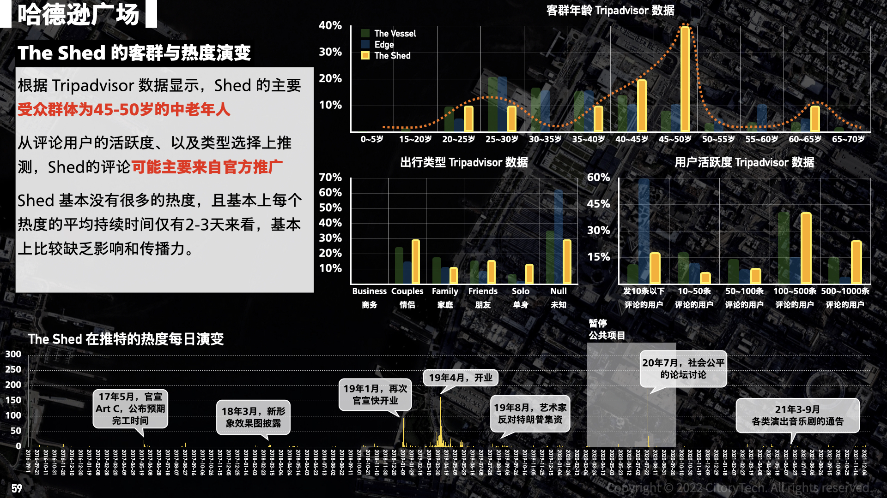{fig-alt="Comment analysis for The Shed at Hudson Yards." loading="lazy"}

# Client deliverable {#client-deliverable}

The project translated the benchmarking results into a spatial decision-support package for the West Bund Financial City context. Deliverables connected public response and customer patterns to design features, amenities, reference projects, and operational strategies. The work was intended to help the client compare precedents and prioritize questions for planning, design, leasing, and district operations.

For a detailed demonstration of the project, please refer to the slides: [Phase I](https://www.dropbox.com/scl/fi/9e1rhg07vftm3qkmwo6i5/0323.pdf?rlkey=hhmkl61vt7ip7kt06c5k7nc5k&dl=0) and [Phase II](https://www.dropbox.com/scl/fi/qgla46f59s2kmdm21dwq8/0531.pdf?rlkey=t6zcpi2w1igjsqwm9edimas37&dl=0).
